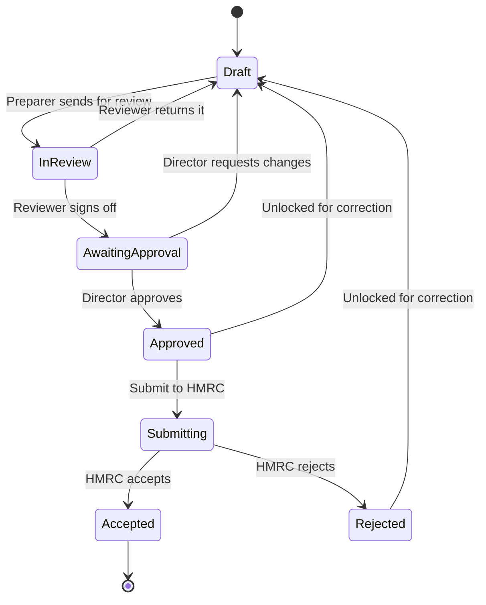
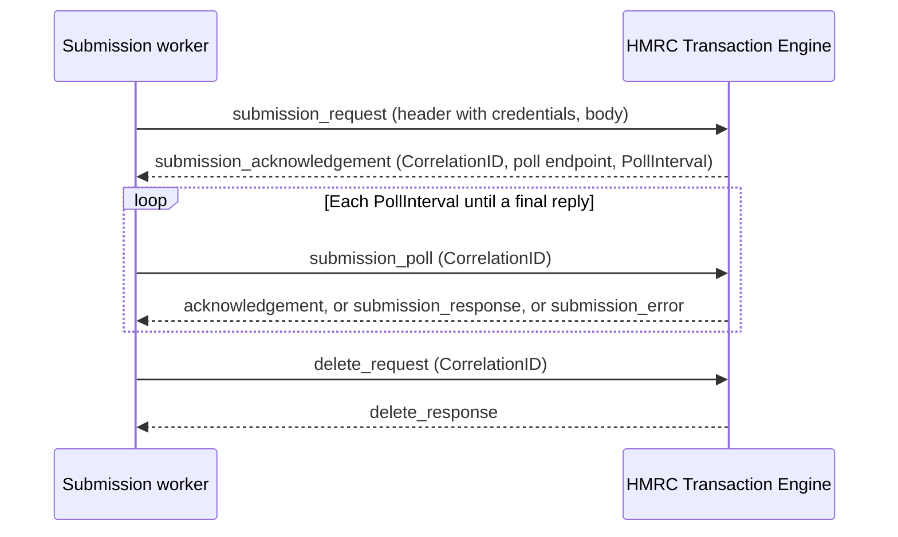
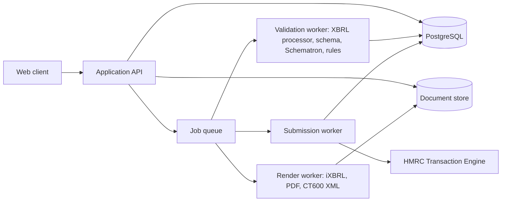

# Account Finalisation and iXBRL Filing App — Specification

| | |
|---|---|
| **Status** | Draft 0.1, for review |
| **Date** | 16 November 2026 |
| **Jurisdiction** | United Kingdom — HMRC Corporation Tax (Companies House filing in a later phase) |

## 1. Summary

The app takes a UK company from a year-end trial balance to a filed Company Tax Return. In one workflow a user:

1. imports the trial balance and finalises the accounts (mapping, year-end adjustments, checks);
2. produces statutory accounts;
3. computes Corporation Tax;
4. generates the three parts of a Company Tax Return — the CT600 form (XML), the accounts (iXBRL) and the tax computations (iXBRL);
5. validates the whole pack locally against HMRC's published rules;
6. obtains director approval; and
7. submits to HMRC's Corporation Tax online service and tracks the submission to HMRC's acceptance receipt.

The design principle that runs through the whole specification is **tag by construction**: accounts and computations are rendered from structured data in which every figure already carries its XBRL concept, period, unit and sign. The app never tags a finished document after the fact, so a displayed figure and its tagged value cannot disagree.

## 2. Assumptions to confirm

The request did not state the target market, entity scope or technology. The specification is written on the assumptions below. Each is a product decision that can be changed; section 17 lists what changes if they are.

| # | Assumption |
|---|---|
| A1 | **Users.** Small accountancy practices filing for many client companies as agents, and directors of single companies filing for themselves. Both use the same workflow; a self-filer simply holds every role. |
| A2 | **Entities in the first release.** Private companies limited by shares that are standalone (not in a group), unaudited, reporting in GBP, and either micro-entities (FRS 105) or small companies (FRS 102 Section 1A). Micro-entities come first. |
| A3 | **Accounts are produced by the app** from the trial balance. Uploading accounts already tagged elsewhere is a secondary route. |
| A4 | **HMRC first, Companies House second.** Companies House filing is a later phase, timed ahead of mandatory software filing in April 2028. |
| A5 | **Hosted, multi-tenant web application**, operated by whoever owns this product. |
| A6 | **The operator registers with HMRC as a software developer**, obtains a vendor ID, and seeks HMRC recognition for Corporation Tax. Live filing is not possible without this. |

## 3. Regulatory context

Positions below are as understood on 16 November 2026. They were compiled from search summaries and secondary reporting, because GOV.UK could not be opened from the environment in which this document was written. **Each row must be re-verified against the primary source in section 18 before it is relied on for implementation.**

| Topic | Position | Consequence for the app |
|---|---|---|
| HMRC's free filing service | The joint Company Accounts and Tax Online service (CATO) closed on 31 March 2026. Company Tax Returns must be filed with commercial software; paper is allowed only in narrow cases. | This is the core market: companies and small practices that previously filed free. |
| Filing channel | A Company Tax Return is a CT600 in XML with iXBRL accounts and iXBRL computations attached, sent through the Government Gateway Transaction Engine in a GovTalk envelope. There is no REST or Making Tax Digital API for Corporation Tax; HMRC confirmed in July 2025 that MTD for Corporation Tax will not go ahead. | The app implements the XML channel (section 8). |
| CT600 version | CT600 version 3. HMRC reissues the schema, Schematron rules and samples ("RIM artefacts") roughly annually. The latest version confirmed was CT600 V3 (2026), artefacts v1.994, dated 10 October 2025; a later one may exist. | The form model, box mapping and validators are versioned and selected by accounting period (section 13). |
| Accepted taxonomies | HMRC publishes which taxonomy versions it accepts for which accounting periods. The FRC 2026 suite (published November 2025) is in vendor use for periods ending after 31 March 2026. The FRC 2027 suite was due for release in November 2026. "Corporation Tax computational 2025" has been added to HMRC's list; its validity window was not confirmed. | The app holds a taxonomy registry with validity windows and selects versions by period (section 13). |
| Tagging obligations | Accounts and computations must be fully tagged. The detailed profit and loss account must be tagged for periods beginning on or after 1 April 2014. HMRC's "joint filing validation checks" define mandatory facts. | Section 9. |
| Standardised computations | HMRC consulted in March 2026 on a prescribed, fully tagged computation format. The timetable was pushed back at Budget 2026 for further engagement. Mandatory online filing of amended returns is expected from 1 April 2028. | Keep the computation layout data-driven so a prescribed format can replace the current one. Support amended returns online. |
| Companies House accounts | Software-only filing of accounts is confirmed for 1 April 2028 (delayed from 2027). The requirement for small companies and micro-entities to file a profit and loss account has been paused. Whether removal of abridged accounts still proceeds was not confirmed. | Phase 3 delivers Companies House filing before April 2028. The filing version of the accounts stays configurable. |
| Accounting standards | FRS 102 Periodic Review 2024 amendments (five-step revenue model, on-balance-sheet leases) apply to periods beginning on or after 1 January 2026. FRS 105 was amended for revenue but keeps operating leases off balance sheet. | Templates and policies are versioned by period start date. |
| Company size thresholds | For periods beginning on or after 6 April 2025: micro — turnover ≤ £1m, balance sheet total ≤ £500k, employees ≤ 10; small — turnover ≤ £15m, balance sheet total ≤ £7.5m, employees ≤ 50. Two of three, with the two-consecutive-years rule. | Drives the size assessment (FR-PER-5). |
| Capital allowances | From 1 January 2026 a new 40% first-year allowance for main-rate expenditure. From 1 April 2026 the main-pool writing-down allowance falls from 18% to 14%, with a hybrid rate for periods straddling that date. | Effective-dated rate tables (section 13). |

## 4. Scope

### 4.1 In scope for the first release (MVP)

- Micro-entity companies under FRS 105, as described in assumption A2.
- Trial balance import from CSV or Excel, account mapping, adjusting journals, a simple fixed asset register and a finalisation checklist.
- Statutory accounts for members and HMRC, including a detailed profit and loss account.
- Corporation Tax computation for a trading company: profit adjustments, capital allowances, trading losses, marginal relief, and tax on loans to participators (CT600A).
- CT600 version 3 main form, with CT600A where needed.
- iXBRL generation for accounts and computations; local validation of the complete pack.
- Review, director approval and locking.
- Submission to HMRC, polling, receipt storage and error handling.
- Amended returns.

### 4.2 Later phases

- Small companies under FRS 102 Section 1A (phase 2).
- Practice features: client list dashboard, deadline tracking, bulk status (phase 2).
- Direct trial balance import from bookkeeping systems such as Xero, QuickBooks Online, FreeAgent and Sage (phase 2).
- Companies House accounts filing (phase 3).
- LLPs, charities, companies limited by guarantee, dormant companies, property investment companies, groups and consolidation, R&D claims and other supplementary pages (phase 4, prioritised by demand).

### 4.3 Out of scope

- Bookkeeping, bank feeds, VAT, payroll and self-assessment.
- Audited accounts, FRS 101, IFRS and full FRS 102 disclosures.
- Companies paying Corporation Tax by quarterly instalments, non-resident companies, controlled foreign companies, ring-fence trades and tonnage tax.
- Tax advice. The app computes from the user's inputs and flags common issues; the preparer remains responsible for the return.

The app must detect circumstances it does not support and stop the user with a clear explanation rather than produce an incomplete return (FR-CT-6).

## 5. Users and roles

| Role | Who | Can do |
|---|---|---|
| Practice admin | Owner or manager of an accountancy practice | Manage users, clients, HMRC agent credentials and billing; everything a reviewer can do |
| Preparer | Accountant or bookkeeper | Create periods, import data, post journals, prepare accounts and computations, run validation |
| Reviewer | Senior accountant | Everything a preparer can do; sign off a pack for approval; submit an approved pack |
| Client approver | Company director | View the final pack through a secure link and approve or reject it; cannot edit |
| Self-filer | Director filing for their own company | All of the above for one company |

A practice may require that preparer and reviewer are different people (configurable four-eyes rule). Tenants are isolated from one another; no role sees another tenant's data.

## 6. Workflow



Within **Draft**, the work proceeds through stages. Each stage shows a status (not started, in progress, complete, stale) and later stages become stale when an earlier one changes.

1. Company and period set-up
2. Trial balance import and mapping
3. Adjustments and finalisation checklist
4. Statutory accounts
5. Tax computation
6. CT600
7. Validation of the full pack

Leaving Draft requires every blocking validation to pass. Approval binds to a hash of the pack (section 7.10), so any later change invalidates the approval. An accepted return is immutable; a correction is made by creating an amended return, which starts a new cycle.

## 7. Functional requirements

Priorities: **M** — required for the MVP; **S** — should be in the MVP if time allows, otherwise phase 2; **L** — later phase.

### 7.1 Tenants and company records

- **FR-ORG-1 (M)** A tenant is either a practice with many client companies or a single company. All data is scoped to a tenant.
- **FR-ORG-2 (M)** A company record holds: registered name, company registration number (CRN), Corporation Tax Unique Taxpayer Reference (UTR), registered office, incorporation date, company type, principal activity, SIC codes, directors, share capital, accounting reference date and trading status.
- **FR-ORG-3 (M)** Validate the CRN format and the UTR format and check digit on entry.
- **FR-ORG-4 (S)** Prefill the company record from the Companies House public data API using the CRN.
- **FR-ORG-5 (M)** Role-based permissions as in section 5.

### 7.2 Periods

Two terms are used precisely. A **period of account** is the period the accounts cover. An **accounting period** is the period a single CT600 covers and cannot exceed 12 months.

- **FR-PER-1 (M)** Create a period of account with start and end dates, defaulted from the accounting reference date and the previous period, or from incorporation for a first period.
- **FR-PER-2 (M)** Derive the Corporation Tax accounting periods. A period of account longer than 12 months yields two accounting periods (the first 12 months, then the remainder), each with its own computation and CT600, both attaching the same accounts. Allow manual adjustment where trade starts or ceases mid-period.
- **FR-PER-3 (M)** Select all date-dependent reference data from the period dates: CT600 version, taxonomy versions, tax rates, allowances and size thresholds.
- **FR-PER-4 (M)** Calculate and display deadlines: Corporation Tax payment, CT600 filing and Companies House filing.
- **FR-PER-5 (M)** Assess company size against the thresholds for this year and the previous year, apply the two-consecutive-years rule and the statutory exclusions, and present the result for the user to confirm. The confirmed size determines which accounting frameworks are offered.
- **FR-PER-6 (M)** Roll a completed period forward: closing balances become comparatives, and account mappings, the fixed asset register, capital allowance pools and tax losses carry over.

### 7.3 Trial balance import and mapping

- **FR-TB-1 (M)** Import a trial balance from CSV or XLSX with account code, account name and either debit and credit columns or a signed balance. Show a preview. Reject a trial balance that does not sum to zero and report the difference.
- **FR-TB-2 (M)** Obtain comparatives from the prior period in the app, or by import or manual entry for a company's first period in the app.
- **FR-TB-3 (M)** Map every client account to a **reporting code** from the app's canonical chart (section 9.2). Unmapped accounts block progress.
- **FR-TB-4 (S)** Suggest mappings from the prior period and from account names and code ranges.
- **FR-TB-5 (M)** Re-import a revised trial balance, show the differences from the previous version, and keep existing mappings and journals. Every imported version is retained.
- **FR-TB-6 (L)** Pull the trial balance directly from bookkeeping systems over their APIs.

### 7.4 Adjustments and finalisation

- **FR-FIN-1 (M)** Post adjusting journals. A journal must balance, be dated within the period, and carry a narrative and a type. The adjusted trial balance is the imported trial balance plus journals.
- **FR-FIN-2 (S)** Provide journal templates for accruals, prepayments, depreciation, closing stock, dividends, director's loan account reclassification and the Corporation Tax charge.
- **FR-FIN-3 (M)** Maintain a simple fixed asset register: asset, category, cost, acquisition and disposal dates and proceeds, depreciation method and rate. It produces the depreciation journal, the fixed asset note and the additions and disposals for capital allowances.
- **FR-FIN-4 (M)** Run a finalisation checklist of automated checks. Blocking: the adjusted trial balance balances; the balance sheet balances; opening reserves equal prior-period closing reserves; suspense accounts are nil; the tax charge in the accounts equals the computation. Advisory: balances with an unexpected sign; an overdrawn director's loan account (prompting the loans-to-participators questions and the related disclosure); fixed assets disagreeing with the register; large movements against the comparative.
- **FR-FIN-5 (M)** Post the Corporation Tax charge from the computation as a journal and mark it stale when the computation changes.
- **FR-FIN-6 (S)** Lead schedules by balance sheet area with working-paper notes and file attachments.
- **FR-FIN-7 (M)** Record every change to data in the audit log (section 12.2).

### 7.5 Statutory accounts

- **FR-ACC-1 (M)** Generate accounts from the adjusted trial balance using a template for the chosen framework and the period's version of the standard: FRS 105 in the MVP; FRS 102 Section 1A in phase 2.
- **FR-ACC-2 (M)** FRS 105 accounts contain: company information; income statement and statement of financial position in the statutory micro-entity formats; the required footnotes (average number of employees; directors' advances, credits and guarantees; financial commitments, guarantees and contingencies); the statutory statements; the approval date and signing director; and a detailed profit and loss account.
- **FR-ACC-3 (M)** Insert statutory statements automatically from recorded facts, for example the audit exemption statement and the micro-entity provisions statement.
- **FR-ACC-4 (M)** Drive disclosures from a questionnaire so that a note appears only when it applies and every answer is captured as data.
- **FR-ACC-5 (M)** Figures in the document always flow from data and cannot be typed over. Narrative is editable within defined text blocks.
- **FR-ACC-6 (M)** Present in whole pounds. Compute totals from rounded components so every statement casts. Where rounding leaves the primary statements inconsistent, apply the difference to a designated line under a documented rule and report it to the preparer.
- **FR-ACC-7 (M)** Produce from the same source: the full accounts as iXBRL for HMRC, including the detailed profit and loss account; a PDF of the same accounts for members and for signing; and, in phase 3, the Companies House filing version.
- **FR-ACC-8 (S)** Accept accounts already tagged in other software: upload the iXBRL file, validate it (section 7.9), read the key tagged facts, and attach it to the return in place of generated accounts.

### 7.6 Tax computation

- **FR-TAX-1 (M)** Start from profit or loss before tax in the accounts and adjust to taxable trading profit. Each reporting code has a default tax treatment (allowable, disallowable, capital, or taxed under another head), so common add-backs such as depreciation, client entertaining and fines are proposed automatically. The preparer can override any item with a reason.
- **FR-TAX-2 (M)** Capital allowances: main pool, special rate pool and single-asset pools; annual investment allowance; full expensing; the 40% first-year allowance; other 100% first-year allowances; structures and buildings allowance; balancing charges and allowances; small-pool write-off; pro-rating for short periods; and the hybrid writing-down rate for periods straddling a rate change.
- **FR-TAX-3 (M)** Other income: non-trading loan relationship income such as bank interest, property income, and chargeable gains entered as a computed figure.
- **FR-TAX-4 (M)** Trading losses: brought forward, used in the current period, carried back to the preceding 12 months, and carried forward. Maintain a loss memorandum across periods.
- **FR-TAX-5 (M)** Qualifying charitable donations.
- **FR-TAX-6 (M)** Calculate Corporation Tax by financial year, apportioning profits on a time basis where an accounting period straddles 31 March. Apply the small profits rate and marginal relief using augmented profits, with limits divided by the number of associated companies plus one and reduced for short periods.
- **FR-TAX-7 (M)** Tax on loans to participators: loans outstanding at the period end, repayments and releases within nine months, and the resulting charge and relief, feeding CT600A.
- **FR-TAX-8 (M)** Income tax deducted at source, and the final tax payable or repayable.
- **FR-TAX-9 (M)** Show the computation as a readable document with supporting schedules, in which every figure traces to its source (a trial balance account, a journal, a register entry or a preparer override).
- **FR-TAX-10 (M)** For a long period of account, apportion trading profit between the two accounting periods on a time basis by default and compute capital allowances separately for each.

### 7.7 CT600

- **FR-CT-1 (M)** Populate the CT600 from the computation and company record through a declarative box mapping held as versioned data, one mapping per form version.
- **FR-CT-2 (M)** Display the CT600 by box number. Each box links to the computation figure it came from. Boxes are not directly editable; the user corrects the source.
- **FR-CT-3 (M)** Apply HMRC's rounding conventions per box as set out in the CT600 Guide.
- **FR-CT-4 (M)** Include CT600A when the loans-to-participators section applies.
- **FR-CT-5 (M)** Capture repayment instructions and bank details where tax is overpaid.
- **FR-CT-6 (M)** Detect unsupported circumstances from the user's answers and the data (for example group relief, R&D claims, instalment payments, non-UK residence) and stop with an explanation of what is unsupported and why.
- **FR-CT-7 (M)** Capture the declaration: the name and status of the person approving the return.

### 7.8 iXBRL generation

- **FR-IX-1 (M)** Render the accounts and the computations as Inline XBRL documents that meet section 9.
- **FR-IX-2 (M)** Tag every figure and every required narrative or categorical fact for which the taxonomy has a concept. No fact is tagged by hand in the MVP; tags come from the reporting code and template definitions.
- **FR-IX-3 (M)** Tag the detailed profit and loss account with the detailed profit and loss concepts.
- **FR-IX-4 (M)** Provide a viewer that shows the rendered document and, for any figure, its concept, context, unit, scale and sign.
- **FR-IX-5 (S)** Allow a preparer to add a custom disclosure with a concept chosen from the taxonomy, for items the templates do not cover.

### 7.9 Validation

Validation runs on demand and automatically before review, approval and submission. Results are grouped by layer; each finding has a severity (blocking or advisory), a plain-English explanation, and a link to the place where it is fixed.

- **FR-VAL-1 (M)** Accounting integrity: the checks in FR-FIN-4.
- **FR-VAL-2 (M)** Tax integrity: the computation casts; loss and pool memoranda reconcile to the prior period; every CT600 box agrees with the computation.
- **FR-VAL-3 (M)** Cross-document consistency: company name, CRN, UTR and period dates agree across the accounts, the computations and the CT600; profit before tax in the computation equals the accounts; turnover agrees.
- **FR-VAL-4 (M)** XBRL validity for both iXBRL documents: well-formed XHTML, Inline XBRL specification conformance, taxonomy and dimensional validity, and calculation consistency.
- **FR-VAL-5 (M)** HMRC filing rules for iXBRL: the joint filing validation checks, the generic dimension validations, the style guide constraints, and the taxonomy being accepted by HMRC for the period.
- **FR-VAL-6 (M)** CT600 validity: the XML schema and the Schematron business rules from the RIM artefacts for the applicable form version.
- **FR-VAL-7 (M)** Envelope validity: the complete GovTalk message validates against the envelope schema and size limits before sending.

Live customer data must never be sent to HMRC's test services, so production validation is entirely local.

### 7.10 Review, approval and locking

- **FR-APP-1 (M)** A reviewer can sign off a pack or return it with comments.
- **FR-APP-2 (M)** The app sends the approver a secure, expiring link to the final pack: accounts PDF, computation, and CT600 in readable form.
- **FR-APP-3 (M)** Approval records the approver's name and capacity, the time, the method of authentication, and a SHA-256 hash of each document in the pack. Agents must not submit without this approval; it is the evidence that the company approved the return before it was sent.
- **FR-APP-4 (M)** An approved pack is locked. Unlocking returns it to Draft and voids the approval.
- **FR-APP-5 (M)** At submission the app recomputes the hashes and refuses to send if they differ from the approved ones.

### 7.11 Submission to HMRC

- **FR-SUB-1 (M)** Build the submission message as specified in section 8, including the IRmark.
- **FR-SUB-2 (M)** Identify the sender as the company or as an agent, using the matching Government Gateway credentials.
- **FR-SUB-3 (M)** Ask for Government Gateway credentials at the point of submission. Credentials are used for that submission and then discarded.
- **FR-SUB-4 (S)** Let a practice opt to store its agent credentials, encrypted as described in section 12.1.
- **FR-SUB-5 (M)** Run the submit, poll and delete protocol in a background worker, with the submission state visible to the user throughout.
- **FR-SUB-6 (M)** On success, store HMRC's response and receipt, mark the return Accepted, and notify the preparer and approver.
- **FR-SUB-7 (M)** On rejection, store the response, translate each error into plain English with a link to the affected data where the error's location can be resolved, mark the return Rejected, and allow it to be unlocked for correction.
- **FR-SUB-8 (M)** Allow only one in-flight submission per return. Never resubmit automatically after an ambiguous failure (section 8.5).
- **FR-SUB-9 (M)** Support HMRC's test environments and Test-in-Live mode through configuration, restricted to non-production data and to operator staff.

### 7.12 After submission

- **FR-POST-1 (M)** Provide a submission record for each return: what was sent, when, by whom, the IRmark, HMRC's correlation ID and HMRC's receipt, downloadable as a filing certificate.
- **FR-POST-2 (M)** Create an amended return from an accepted return. It copies the period's data into a new draft, is marked as amended in the CT600, and follows the full workflow. Warn when the statutory amendment window has passed.
- **FR-POST-3 (S)** A dashboard of companies, periods, statuses and approaching deadlines.
- **FR-POST-4 (M)** Export the complete pack and submission evidence for a period as an archive.

### 7.13 Companies House filing (phase 3)

- **FR-CH-1 (L)** Generate the Companies House filing version of the accounts as iXBRL, without the detailed profit and loss account, following the filing options in force for the company's size.
- **FR-CH-2 (L)** Submit through the Companies House software filing gateway using the presenter's credentials and the company authentication code; poll for acceptance or rejection; store the outcome.
- **FR-CH-3 (L)** Meet whatever identity verification and authorised-agent requirements apply to software filers at the time.

## 8. HMRC submission: technical specification

HMRC's published documents are authoritative: the Transaction Engine Document Submission Protocol, the GovTalk envelope schema, the CT600 RIM artefacts, and the IRmark guidance. The detail below records the design intent and is to be checked against those documents at implementation.

### 8.1 Message structure

A submission is one XML document: a GovTalk envelope whose body holds an `IRenvelope` in the Corporation Tax namespace.

```xml
<GovTalkMessage xmlns="http://www.govtalk.gov.uk/CM/envelope">
  <EnvelopeVersion>2.0</EnvelopeVersion>
  <Header>
    <MessageDetails>
      <Class>HMRC-CT-CT600</Class>            <!-- HMRC-CT-CT600-TIL for Test in Live -->
      <Qualifier>request</Qualifier>
      <Function>submit</Function>
      <CorrelationID/>
      <Transformation>XML</Transformation>
      <GatewayTest>0</GatewayTest>            <!-- 1 on test services -->
    </MessageDetails>
    <SenderDetails>
      <IDAuthentication>
        <SenderID>Government Gateway user ID</SenderID>
        <Authentication>
          <Method>clear</Method>
          <Value>password</Value>
        </Authentication>
      </IDAuthentication>
    </SenderDetails>
  </Header>
  <GovTalkDetails>
    <Keys><Key Type="UTR">1234567890</Key></Keys>
    <ChannelRouting>
      <Channel>
        <URI>vendor ID</URI><Product>product name</Product><Version>product version</Version>
      </Channel>
    </ChannelRouting>
  </GovTalkDetails>
  <Body>
    <IRenvelope xmlns="http://www.govtalk.gov.uk/taxation/CT/5">
      <IRheader>
        <Keys><Key Type="UTR">1234567890</Key></Keys>
        <PeriodEnd>2026-03-31</PeriodEnd>
        <DefaultCurrency>GBP</DefaultCurrency>
        <IRmark Type="generic">base64 digest</IRmark>
        <Sender>Company</Sender>              <!-- or Agent -->
      </IRheader>
      <CompanyTaxReturn ReturnType="new">     <!-- or amended -->
        <!-- company information, return summary, turnover, tax calculation,
             supplementary pages, declaration: per the CT600 schema -->
        <AttachedFiles>
          <XBRLsubmission>
            <Computation><Instance><InlineXBRLDocument><!-- iXBRL --></InlineXBRLDocument></Instance></Computation>
            <Accounts><Instance><InlineXBRLDocument><!-- iXBRL --></InlineXBRLDocument></Instance></Accounts>
          </XBRLsubmission>
        </AttachedFiles>
      </CompanyTaxReturn>
    </IRenvelope>
  </Body>
</GovTalkMessage>
```

Element names, order and the namespace version come from the RIM artefacts for the form version in use. The CT600 XML is generated from the schema-derived model, never by string templating. The iXBRL documents are embedded exactly as validated and approved, in whichever of the schema's embedding forms (inline or encoded) is chosen at implementation.

### 8.2 IRmark

The IRmark is a digest of the message body that HMRC uses to prove what was submitted.

1. Take the `Body` element with its in-scope namespace declarations.
2. Remove the `IRmark` element.
3. Canonicalise using W3C Canonical XML 1.0.
4. Compute the SHA-1 digest of the canonical bytes.
5. Base64-encode the digest and insert it as the `IRmark` value.

The Base32 form of the same digest is shown to users on the filing certificate. The app verifies the IRmark HMRC returns in its receipt against the one it sent. The implementation is proven by reproducing the IRmark of every HMRC-published sample (section 15).

### 8.3 Protocol



- All messages are HTTPS POSTs of XML.
- The poll and delete messages carry the correlation ID, not the credentials, so credentials are needed only for the initial request.
- The worker honours the poll interval HMRC returns and stops polling after a configurable ceiling, leaving the submission in a state that an operator or the user can resume.
- After a final reply the worker sends the delete request so the result is removed from the gateway.
- A list request can retrieve outstanding correlation IDs for the sender; it is used for reconciliation (section 8.5).

### 8.4 Environments

| Environment | Purpose | Notes |
|---|---|---|
| Local Test Service | HMRC's downloadable validator for schema and business rules | Used in development and in automated tests |
| External Test Service | End-to-end test of envelope, credentials and messaging, with body validation including XBRL | Test credentials from HMRC; `GatewayTest` set to 1; never live customer data. Submission URL seen in HMRC guidance: `https://test-transaction-engine.tax.service.gov.uk/submission` |
| Test in Live | Checks connectivity to the live service without filing a return | Message class `HMRC-CT-CT600-TIL` |
| Live | Real filing | Message class `HMRC-CT-CT600`; endpoint as given in the current protocol document |

Endpoints, message classes and the vendor ID are configuration, not code.

### 8.5 Submission states and failure handling

| State | Meaning | Next |
|---|---|---|
| Prepared | Message built, IRmark computed, final validation passed | Sent |
| Sent | Request posted; no reply yet | Acknowledged, Failed or Unknown |
| Acknowledged | Correlation ID received; polling | Accepted or Rejected |
| Accepted | HMRC success response stored | Closed after delete |
| Rejected | HMRC error response stored | Return unlocked for correction |
| Failed | The request demonstrably did not reach HMRC (for example connection refused) | May be retried |
| Unknown | The request may have reached HMRC but no acknowledgement was received | Reconcile before any retry |

Rules:

- **No blind retry.** A submission in the Unknown state is reconciled with a list request and, if needed, manual confirmation, before another attempt is allowed. This prevents duplicate filings.
- **Error classes.** Transport and gateway errors (for example authentication failure) are shown as such and never unlock the return. Business errors returned in the body (schema, business-rule and XBRL failures) carry an error code, a message and a location; the app stores them verbatim and shows a translated version.
- **Authentication failure** prompts for credentials again; the credentials are not retained.
- **Persistence.** The worker is restart-safe: state is committed before each network call, and polling resumes from stored state.

### 8.6 Evidence retained

For every attempt: the exact bytes of the submitted body and their SHA-256 hash; the header with the password removed; the IRmark; the correlation ID; every HMRC reply verbatim; timestamps; and the acting user. This record is write-once (section 12.2).

## 9. iXBRL: technical specification

### 9.1 Document rules

- One self-contained XHTML file per document, UTF-8, well-formed, using Inline XBRL in the version the HMRC technical pack specifies.
- No scripts and no external resources. Styles are inline or in an embedded stylesheet; images are embedded.
- One `schemaRef` to the entry point of an HMRC-accepted taxonomy for the period, taken from the taxonomy registry.
- Accounts contexts identify the entity by CRN under the Companies House scheme (`http://www.companieshouse.gov.uk/`). Computation contexts identify it by UTR under the scheme the computational taxonomy requires.
- Contexts are generated, never hand-written: instants for balance sheet dates, durations for the period and the comparative, plus dimensional contexts as the taxonomy requires.
- Units: `iso4217:GBP` for money, `pure` for ratios and counts, `shares` for share numbers.
- Numeric facts carry the correct `decimals`, `scale`, `format` and `sign`. Negative values are tagged as positive numbers with `sign="-"` where the concept's balance requires, with brackets rendered outside the tagged content. Only number formats supported by the HMRC technical pack are used.
- Facts that must be reported but are not displayed (for example entity trading status or accounts type) go in the hidden section of the Inline XBRL header.
- The comparative period is tagged to the same standard as the current period.

### 9.2 Canonical chart and tag definitions

The mapping in FR-TB-3 targets a canonical chart of **reporting codes**. Each reporting code defines, per accounting framework and taxonomy version:

- the statement and line where the balance is presented, and its normal sign;
- the accounts taxonomy concept and any dimension members;
- the detailed profit and loss concept;
- the default tax treatment (FR-TAX-1) and, where relevant, the computational taxonomy concept.

Templates define the facts that do not come from account balances: totals and subtotals, notes, statutory statements, dates, names and the hidden categorical facts. A template is a structured definition (sections, lines, fact bindings and narrative blocks), rendered to XHTML for iXBRL and to PDF.

Reporting codes and templates are versioned data. Moving to a new taxonomy or a new edition of a standard is a data change with tests, not a code rewrite.

### 9.3 Mandatory facts

The generator always emits, and the validator checks, the facts that HMRC's joint filing validation checks require. Examples: entity name; CRN; period start and end dates; balance sheet date; whether the entity is dormant; trading status; accounting standards applied; accounts type; whether the accounts are audited; date of approval; name of the approving director; and the legal form. The current version of the checks document is the authority for the full list and the rule numbers.

### 9.4 Validation engine

Use an established XBRL processor rather than writing one. **Arelle** (open source, XBRL International certified) is the default choice. Taxonomy packages for every supported FRC and HMRC taxonomy are bundled and loaded offline; validation makes no network requests. HMRC-specific checks that the processor does not cover are implemented as the app's own rule set, each rule traceable to the HMRC rule number.

HMRC's gateway uses its own processor, so local results can differ at the edges. The external test service is the arbiter, and every divergence found becomes a regression test.

## 10. Data model

Main entities and what they hold. Monetary amounts are stored as integer pence; calculations use decimal arithmetic, never binary floating point.

| Entity | Holds |
|---|---|
| Tenant | Practice or single company; settings; optional encrypted agent credentials |
| User, Membership | Identity, role within a tenant |
| Company | Record in FR-ORG-2 |
| PeriodOfAccount | Dates, framework, size assessment, workflow state, reference-data versions selected |
| AccountingPeriod | Corporation Tax period within a period of account |
| TrialBalanceVersion, TrialBalanceLine | Each import, with source file and hash |
| AccountMapping | Client account to reporting code |
| Journal, JournalLine | Adjustments |
| FixedAsset | Register entries |
| DisclosureAnswer | Questionnaire responses and narrative blocks |
| TaxComputation, TaxAdjustment, CapitalAllowancePool, LossRecord | Computation inputs, overrides and memoranda |
| Ct600Return | Box values, supplementary pages, declaration, return type (new or amended) |
| GeneratedDocument | Each rendered iXBRL, PDF or XML file, with content hash and the versions of data, templates and taxonomies that produced it |
| ValidationRun, ValidationFinding | Results by layer |
| Approval | Approver, time, authentication method, pack hashes |
| Submission, SubmissionEvent | Attempts, states, HMRC messages (section 8.6) |
| ReferenceData | Rate tables, thresholds, taxonomy registry, form versions, reporting codes, templates — all effective-dated and versioned |
| AuditEvent | Append-only log |

Generated documents are reproducible: the same inputs and versions always produce byte-identical output. This is what allows hashes to bind an approval to a submission.

## 11. Architecture

### 11.1 Components



- **Web client** — the workflow, document viewers and dashboards.
- **Application API** — domain logic, permissions and workflow state.
- **Render worker** — produces documents deterministically from data and versioned templates.
- **Validation worker** — runs the layers in section 7.9. Isolated because the XBRL processor is memory-hungry and slow to start.
- **Submission worker** — the only component that talks to HMRC, and the only one that handles Government Gateway credentials.
- **Document store** — object storage with write-once retention for submission evidence.

The domain core (accounts, tax, CT600 mapping) is a library with no web or database dependencies, so it can be tested exhaustively with plain inputs and outputs.

### 11.2 Recommended technology

A recommendation, not a constraint; the repository is empty and nothing depends on it yet.

| Layer | Recommendation | Reason |
|---|---|---|
| Backend and workers | Python 3.12+ with FastAPI | Arelle is a Python library; `lxml` provides schema validation and XML canonicalisation; `decimal` is in the standard library |
| Database | PostgreSQL | Transactions, row-level security for tenant isolation, JSON for versioned reference data |
| Job queue | PostgreSQL-backed queue initially | One fewer moving part; replace with a dedicated broker if volume demands |
| iXBRL and PDF rendering | Structured templates rendered to XHTML; an HTML-to-PDF engine for the PDF | One source for both outputs |
| Schematron | An XSLT engine matching the query binding HMRC's Schematron uses | To be confirmed from the RIM artefacts; `lxml` supports XSLT 1.0 only |
| Web client | TypeScript with React | Mainstream; strong typing for a form-heavy UI |
| Hosting | Containers in a UK cloud region, managed PostgreSQL, managed key service | Data residency and operational simplicity |

## 12. Non-functional requirements

### 12.1 Security and privacy

- TLS 1.2 or later for all traffic; encryption at rest for the database, document store and backups.
- Multi-factor authentication for all practice users; single-use, expiring links plus a second factor for client approvers.
- Tenant isolation enforced in the database as well as in application code.
- **Government Gateway credentials** are never logged, never written to the stored copy of a message, and never returned by any API. By default they exist only in memory in the submission worker for one request. Where a practice opts to store them, they are encrypted with a per-tenant key held in a managed key service and decrypted only inside the submission worker.
- Personal data is limited to what filing requires. The operator acts as processor for practices and as controller for its own account data; a data processing agreement and privacy notice are required before launch.
- Bank details captured for repayments are encrypted at field level.
- Independent penetration test before live filing, and annually.
- Dependency and container scanning in continuous integration.

### 12.2 Audit and record keeping

- An append-only audit log records who did what and when for every change to accounting data, tax data, mappings, approvals, unlocks and submissions.
- Submission evidence and approved packs are stored write-once.
- Records are retained for at least six years from the end of the accounting period, configurable upward, and remain exportable if a tenant leaves.

### 12.3 Reliability and performance

- Target availability 99.5% monthly, with planned maintenance kept away from filing peaks (the end of December, March and September).
- Recovery point objective 15 minutes; recovery time objective 4 hours; restores tested quarterly.
- For a typical small-company pack: document generation within 10 seconds; full validation within 60 seconds. Both run in the background with visible progress.
- HMRC outages and slow responses must not lose a submission or corrupt its state (section 8.5).

### 12.4 Usability and accessibility

- WCAG 2.2 level AA.
- Plain-English guidance at each stage aimed at a director with no accounting training, with accounting terminology available to professionals.
- Every validation finding and every HMRC error explains what is wrong and where to fix it.

### 12.5 Observability

- Structured logs with secrets redacted, metrics for each workflow stage and each HMRC call, and alerts on submission failures, stuck submissions and unusual rejection rates.

## 13. Reference data and annual maintenance

Tax and filing rules change every year, so they are data with effective dates, not constants in code.

| Reference data | Changes when | Selected by |
|---|---|---|
| CT600 schema, Schematron, box mapping | HMRC issues new RIM artefacts, typically for each April | Accounting period dates |
| Taxonomy registry: versions, entry points, HMRC validity windows | FRC and HMRC publish new taxonomies; HMRC updates its accepted list | Period end date |
| Reporting codes and templates | A taxonomy or accounting standard changes | Framework and period start date |
| Tax rates, limits and allowances | Budgets and Finance Acts | Financial year or transaction date |
| Size thresholds | Regulations | Period start date |

Seed values for the tax tables, **to be verified against legislation before use**:

| Item | Value |
|---|---|
| Main rate | 25% (profits above £250,000) |
| Small profits rate | 19% (profits up to £50,000) |
| Marginal relief | Standard fraction 3/200 between the limits; limits divided by associated companies plus one and reduced for short periods |
| Annual investment allowance | £1,000,000 |
| Full expensing | 100% main-rate and 50% special-rate first-year allowances for new plant bought by companies |
| 40% first-year allowance | Main-rate expenditure from 1 January 2026, with exclusions including cars and second-hand assets |
| Main pool writing-down allowance | 18% to 31 March 2026; 14% from 1 April 2026; hybrid rate for straddling periods |
| Special rate pool writing-down allowance | 6% |
| Structures and buildings allowance | 3% straight line |
| Tax on loans to participators | Tracks the dividend upper rate for the tax year in which the loan is made: 33.75% to 5 April 2026; believed 35.75% from 6 April 2026 |

An annual maintenance cycle is part of the product: monitor HMRC's "changes and issues" page and the FRC taxonomy pages; load new artefacts into a staging environment; run the full regression suite; pass the external test service; renew HMRC recognition; then release. Each reference-data change is reviewed by a qualified accountant or tax adviser.

## 14. HMRC onboarding and recognition

1. Register as a software developer with HMRC's Software Developers Support Team to obtain a vendor ID and test credentials.
2. Download the current technical pack: RIM artefacts, valid XML samples, the XBRL technical pack and style guide, the joint filing validation checks, the Local Test Service, the Document Submission Protocol and the IRmark guidance.
3. Develop against the Local Test Service and then the External Test Service.
4. Apply for recognition: request the applicant's pack, submit HMRC's test scenarios successfully, and send the outputs for review.
5. On recognition, the product is listed on GOV.UK as a commercial software supplier for Corporation Tax. Recognition is renewed annually.

Recognition lead time is outside the team's control and gates live filing, so step 1 starts on day one of the project.

## 15. Testing and acceptance

- **Golden cases.** A library of synthetic companies, each with a trial balance and expected accounts, computation, CT600 boxes and iXBRL facts, reviewed by a qualified accountant. It covers: profit and loss positions; each marginal-relief band; short and long periods; periods straddling 31 March and 1 April 2026; associated companies; each capital allowance type; loss carry-back and carry-forward; an overdrawn director's loan.
- **HMRC samples.** Every HMRC valid XML sample passes local schema and Schematron validation, and the IRmark implementation reproduces each sample's IRmark exactly.
- **Property tests** for the invariants: statements cast; the balance sheet balances; displayed and tagged values are equal; generation is deterministic.
- **XBRL conformance.** Every generated document passes the XBRL processor and the HMRC rule set, with deliberate-error cases proving that each rule fires.
- **Protocol tests** against a simulator of the Transaction Engine covering every state and failure in section 8.5, including lost acknowledgements and worker restarts mid-poll.
- **External Test Service** runs for every golden case before each release.
- **Security tests**, including a check that credentials never appear in logs, stored messages or API responses.

The MVP is accepted when: all the above pass; HMRC recognition is granted; and real returns for at least three pilot companies, prepared in parallel by a qualified accountant using established software, produce the same figures and are accepted by HMRC.

## 16. Delivery phases

| Phase | Outcome |
|---|---|
| 0. Foundations | HMRC developer registration under way; technical pack obtained; a spike that builds a message from an HMRC sample, computes the IRmark, and completes a round trip with the External Test Service; XBRL processor running with bundled taxonomies; domain model and reference-data framework in place |
| 1. MVP | Micro-entity companies end to end as in section 4.1; HMRC recognition; pilot filings |
| 2. Small companies and practices | FRS 102 Section 1A; practice dashboard; bookkeeping integrations; stored agent credentials |
| 3. Companies House | Accounts filing through the Companies House gateway, live well before 1 April 2028 |
| 4. Breadth | Further entity types and supplementary pages by demand; HMRC's prescribed computation format when finalised |

## 17. Risks and open questions

### 17.1 Risks

| Risk | Mitigation |
|---|---|
| HMRC recognition takes longer than development | Start registration immediately; build to the test services from phase 0 |
| Local validation passes but HMRC rejects | External Test Service runs for all golden cases; every divergence becomes a regression test; clear rejection handling |
| Annual rule changes arrive late or change again (new RIM artefacts, taxonomy acceptance dates) | Reference data as versioned data; staging pipeline; block periods for which no accepted taxonomy or form version is loaded, with an explanation |
| Incorrect tax or accounting output | Qualified review of templates, rules and golden cases; supported scope enforced by FR-CT-6; pilot in parallel with established software |
| Duplicate or lost submissions | State machine in section 8.5; no blind retry; reconciliation |
| Credential compromise | Section 12.1; credentials not stored by default |
| HMRC's prescribed computation format and Companies House reforms shift again | Data-driven templates; configurable filing versions; track announcements |
| The regulatory facts in section 3 are wrong or out of date | Verify every row against primary sources before implementation |

### 17.2 Open questions

1. **Market (A1).** Practices, self-filing directors, or both? This drives the interface, pricing and support model. A self-filer-only product needs far more guidance and stricter scope guards; a practice-only product needs bulk and review features sooner.
2. **Entity scope (A2).** Are dormant companies, property companies or LLPs needed in the first release?
3. **Operator (A6).** Which legal entity will register with HMRC and operate the service?
4. **Technology (section 11.2).** Is there an existing preference or team skill set that should override the recommendation?
5. **Companies House (A4).** Should filing be brought into the MVP, given that most users must file the same accounts there?
6. **Integrations.** Which bookkeeping systems matter most to the intended users?
7. **Professional oversight.** Who provides the qualified accounting and tax review that sections 13 and 15 depend on?

## 18. References

Primary sources to verify against:

- HMRC — [CT600 RIM artefacts](https://www.gov.uk/government/publications/corporation-tax-technical-specifications-ct600-rim-artefacts)
- HMRC — [CT600 valid XML samples](https://www.gov.uk/government/publications/corporation-tax-technical-specifications-ct600-valid-xml-samples)
- HMRC — [Corporation Tax technical specifications: XBRL and iXBRL](https://www.gov.uk/government/publications/corporation-tax-technical-specifications-xbrl-and-ixbrl) (technical pack, style guide, joint filing validation checks)
- HMRC — [Corporation Tax generic technical specifications](https://www.gov.uk/government/publications/corporation-tax-generic-technical-specifications) (including recognition instructions)
- HMRC — [Taxonomies accepted by HMRC](https://www.gov.uk/government/publications/taxonomies-accepted-by-hm-revenue-and-customs)
- HMRC — [Changes and issues affecting the Corporation Tax online service](https://www.gov.uk/guidance/changes-and-issues-affecting-the-corporation-tax-online-service)
- HMRC — [Basic guide for XML software developers](https://www.gov.uk/guidance/basic-guide-for-xml-software-developers)
- HMRC — [Commercial software suppliers for Corporation Tax](https://www.gov.uk/government/publications/corporation-tax-commercial-software-suppliers)
- HMRC — [Income and Corporation Taxes electronic communications direction](https://www.gov.uk/government/publications/directions-under-regulations-3-and-10-of-the-income-and-corporation-taxes-electronic-communications-regulations-2003-si-2003282/income-and-corporation-taxes-electronic-communications-direction)
- HMRC — [Modernising and standardising company tax returns (consultation)](https://www.gov.uk/government/consultations/modernising-and-standardising-company-tax-returns--2/modernising-and-standardising-company-tax-returns)
- HMRC — [New first-year allowance and main rate of writing-down allowances](https://www.gov.uk/government/publications/new-first-year-allowance-and-main-rate-of-writing-down-allowances)
- Companies House — [Update to accounts filing from April 2028](https://www.gov.uk/government/news/companies-house-update-to-accounts-filing-from-april-2028)
- Companies House — [Technical interface specifications for software](https://www.gov.uk/government/publications/technical-interface-specifications-for-companies-house-software)
- FRC — [Current taxonomy suites](https://www.frc.org.uk/library/standards-codes-policy/accounting-and-reporting/frc-taxonomies/current-frc-taxonomy-suites/)

Secondary reporting used for section 3:

- ATT — [Online company accounts and tax filing service to close](https://www.att.org.uk/technical/news/online-company-accounts-and-tax-filing-service-close)
- Accountancy Age — [No plans for MTD for corporation tax, says HMRC](https://accountancyage.com/2025/07/22/no-plans-for-mtd-for-corporation-tax-says-hmrc/)
- ICAEW — [Companies House: accounts changes confirmed for April 2028](https://www.icaew.com/insights/viewpoints-on-the-news/2026/jun-2026/companies-house-accounts-changes-confirmed-for-april-2028)
- ICAEW — [HMRC consults on changes to company tax returns](https://www.icaew.com/insights/tax-news/2026/mar-2026/hmrc-consults-on-changes-to-company-tax-returns)
- Accountancy Daily — [Budget 2026: delay to single XBRL corporation tax computations](https://www.accountancydaily.co/budget-2026-delay-single-xbrl-corporation-tax-computations)

## Glossary

| Term | Meaning |
|---|---|
| Accounting period | The period one CT600 covers; at most 12 months |
| CRN | Company registration number issued by Companies House |
| CT600 | The Company Tax Return form |
| DPL | Detailed profit and loss account: the full income and expense analysis, given to HMRC but not filed publicly |
| FRS 102 Section 1A / FRS 105 | UK accounting standards for small entities and micro-entities |
| GovTalk | The XML envelope format used by the Government Gateway |
| iXBRL | Inline XBRL: a human-readable XHTML document with machine-readable XBRL tags embedded |
| IRmark | A digest of the submission body that identifies exactly what was filed |
| Period of account | The period the accounts cover |
| RIM artefacts | HMRC's package of schema, business rules and samples for a form version |
| Taxonomy | The dictionary of XBRL concepts for a reporting framework |
| Transaction Engine | The Government Gateway service that receives XML submissions for HMRC |
| UTR | Unique Taxpayer Reference; here, the company's Corporation Tax reference |
