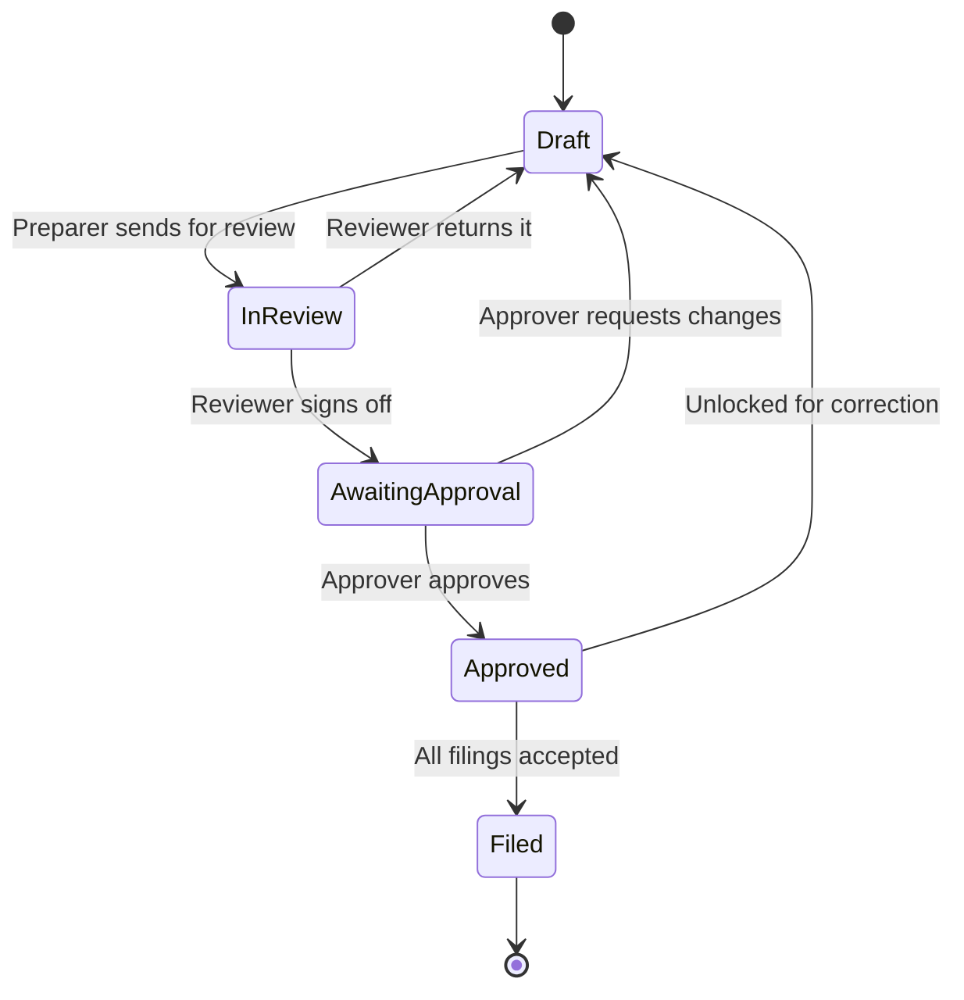
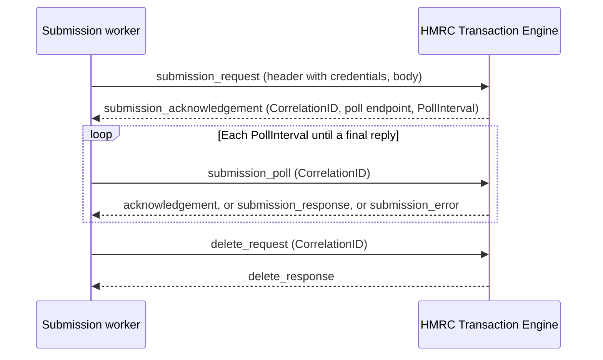
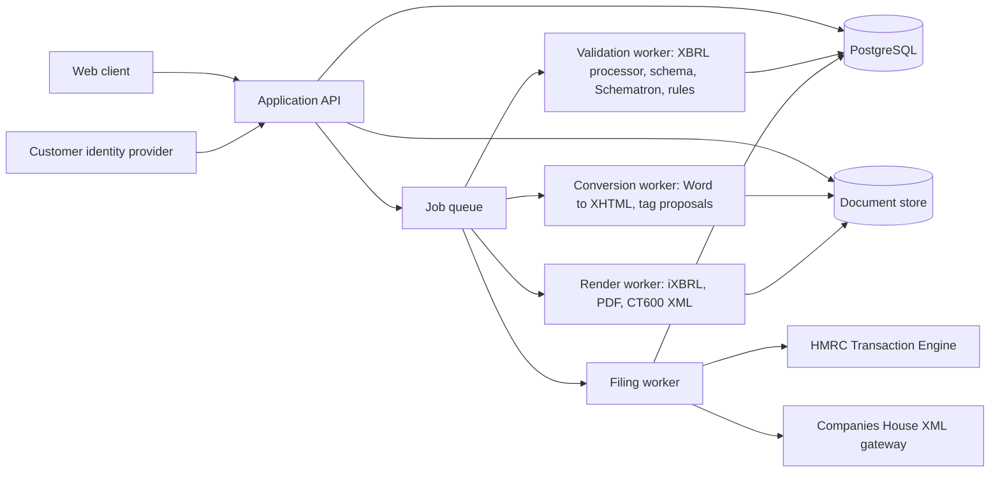

# Account Finalisation and iXBRL Filing App — Specification

| | |
|---|---|
| **Status** | Draft 0.3, for review |
| **Date** | 16 November 2026 |
| **Jurisdiction** | United Kingdom — HMRC Corporation Tax and Companies House |
| **Changes since 0.2** | Three decisions recorded: the director release comes first; large organisations report under IFRS or FRS; large-company accounts are imported and tagged, with a designed path to drafting them in the app later (section 10.5). |

## 1. Summary

The app takes a UK company from a year-end trial balance to accounts filed at Companies House and a Company Tax Return filed with HMRC. In one workflow a user:

1. imports the trial balance and finalises the accounts (mapping, year-end adjustments, checks);
2. produces or imports the statutory accounts;
3. computes Corporation Tax;
4. produces the filing documents — accounts in iXBRL, tax computations in iXBRL, and the CT600 form in XML;
5. validates everything locally against the published HMRC and Companies House rules;
6. obtains approval; and
7. files with Companies House and HMRC, tracking each filing to acceptance.

It serves two kinds of user: directors filing for their own small company, and the in-house finance and tax teams of large UK organisations filing for one company or a group.

Accounts reach iXBRL by one of two routes, and the difference matters throughout the specification:

- **Generated.** For micro-entities and small companies, the app renders the accounts from structured data in which every figure already carries its XBRL concept, period, unit and sign. Nothing is tagged after the fact, so a displayed figure and its tagged value cannot disagree. Tax computations are always produced this way, for every company.
- **Imported and tagged.** A large company's accounts are a bespoke document agreed with its auditors. The app imports that document, proposes tags, and gives the finance team a workbench to review and complete them, with automatic checks that the tagged figures agree with the trial balance. The design keeps open a later step in which the app drafts these accounts itself (section 10.5).

## 2. Decisions and assumptions

### 2.1 Decisions made by the product owner

| # | Decision |
|---|---|
| D1 | **Target users** are primarily company directors and large UK organisations. Accountancy practices are not a primary segment. |
| D2 | **The product owner registers as a software developer with both HMRC and Companies House.** |
| D3 | **Companies House filing is in the first release.** Inferred from D2. |
| D4 | **The director release comes first**, then the large-organisation release. It is the smallest complete filing loop and is what HMRC recognition is obtained on. |
| D5 | **Large organisations report under IFRS or FRS**: UK-adopted IFRS, FRS 101 or FRS 102. All three are supported in release 2. |
| D6 | **Large-company accounts are imported and tagged**, not drafted in the app. The design must allow drafting to be added later without rework (section 10.5). |

### 2.2 Assumptions to confirm

| # | Assumption |
|---|---|
| A1 | **"Large UK organisation"** means a UK company, or a UK group of companies, that does not qualify for the small companies regime: medium-sized or large under the Companies Act, usually audited, usually with an in-house finance team, often with several UK subsidiaries. |
| A2 | **"Directors"** means directors of micro-entities and small companies who file for their own company without an accountant. |
| A3 | **Small-company accounts are generated**, in release 3, in the same way as micro-entity accounts in release 1. Any company may instead use the import route once it exists. |
| A4 | **Users file as the company, not as an agent.** A director or an employee files with the company's own HMRC and Companies House credentials. Filing as a tax agent is deferred. |
| A5 | **Hosted, multi-tenant web application** operated by the product owner. |

## 3. Regulatory context

Positions below are as understood on 16 November 2026. They were compiled from search summaries and secondary reporting, because GOV.UK could not be opened from the environment in which this document was written. **Each row must be re-verified against the primary source in section 19 before it is relied on for implementation.**

| Topic | Position | Consequence for the app |
|---|---|---|
| HMRC's free filing service | The joint Company Accounts and Tax Online service (CATO) closed on 31 March 2026. Company Tax Returns must be filed with commercial software; paper is allowed only in narrow cases. | Directors who previously filed free are the first market. |
| HMRC filing channel | A Company Tax Return is a CT600 in XML with iXBRL accounts and iXBRL computations attached, sent through the Government Gateway Transaction Engine in a GovTalk envelope. There is no REST or Making Tax Digital API for Corporation Tax; HMRC confirmed in July 2025 that MTD for Corporation Tax will not go ahead. | Section 8. |
| CT600 version | CT600 version 3. HMRC reissues the schema, Schematron rules and samples ("RIM artefacts") roughly annually. The latest version confirmed was CT600 V3 (2026), artefacts v1.994, dated 10 October 2025; a later one may exist. | The form model, box mapping and validators are versioned and selected by accounting period (section 14). |
| Accepted taxonomies | HMRC publishes which taxonomy versions it accepts for which accounting periods; Companies House aligns its list with HMRC's. The FRC 2026 suite (published November 2025) is in vendor use for periods ending after 31 March 2026. The FRC 2027 suite was due in November 2026. "Corporation Tax computational 2025" has been added to HMRC's list; its validity window was not confirmed. | A taxonomy registry with validity windows, selected by period (section 14). |
| Tagging obligations | Accounts and computations must be fully tagged. The detailed profit and loss account must be tagged for periods beginning on or after 1 April 2014. HMRC's "joint filing validation checks" define mandatory facts. | Section 10. |
| Standardised computations | HMRC consulted in March 2026 on a prescribed, fully tagged computation format. The timetable was pushed back at Budget 2026. Mandatory online filing of amended returns is expected from 1 April 2028. | Keep the computation layout data-driven so a prescribed format can replace the current one. Support amended returns online. |
| Companies House accounts filing | Accounts filed with software go through the Companies House XML gateway in iXBRL. Software-only filing of accounts is confirmed for 1 April 2028 (delayed from 2027); web and paper routes for accounts close then. The requirement for small companies and micro-entities to file a profit and loss account has been paused. Whether removal of abridged accounts still proceeds was not confirmed. | From April 2028 every company, including large ones that file on paper or PDF today, needs software. Section 9. The filing version of the accounts stays configurable. |
| Account types accepted by Companies House software filing | Vendor documentation is inconsistent about whether audited medium and large full accounts, group accounts and IFRS accounts are accepted today. An older Companies House note says only UK GAAP accounts could be filed electronically; it is probably out of date. The Companies House technical interface specification for accounts (v5.7, 2025) is the authority. | Must be confirmed before release 2 is planned in detail (risk in section 18.1). |
| Companies House presenter rules | Compulsory identity verification for anyone filing, and the requirement that third-party agents be registered as Authorised Corporate Service Providers, are now due no earlier than November 2027, with at least six months' notice. | Each customer files under its own presenter credentials (FR-CH-4) so the product owner is a software supplier, not a filing agent. |
| Accounting standards | FRS 102 Periodic Review 2024 amendments (five-step revenue model, on-balance-sheet leases) apply to periods beginning on or after 1 January 2026. FRS 105 was amended for revenue but keeps operating leases off balance sheet. | Templates, policies and reporting codes are versioned by period start date. |
| IFRS and FRS 101 | The FRC taxonomy suite has entry points for UK-adopted IFRS and for FRS 101 as well as FRS 102. IFRS 18 changes the presentation of the income statement for periods beginning on or after 1 January 2027, and related UK amendments take effect from the same date; the FRC 2027 suite is expected to cover them. | Release 2 must handle both the current and the IFRS 18 presentation, selected by period start date. |
| Company size thresholds | For periods beginning on or after 6 April 2025 (two of three, with the two-consecutive-years rule): micro — turnover ≤ £1m, balance sheet total ≤ £500k, employees ≤ 10; small — ≤ £15m, ≤ £7.5m, ≤ 50; medium — ≤ £54m, ≤ £27m, ≤ 250. Larger companies are large. | Drives the size assessment (FR-PER-5) and which route and release serve a company. |
| Quarterly instalment payments | A company whose augmented profits exceed £1.5m pays Corporation Tax in quarterly instalments, and one above £20m pays earlier; both limits are divided by the number of associated companies plus one. There are exceptions for a company's first large period. | Out of scope for release 1; required in release 2 (FR-TAX-14). |
| Capital allowances | From 1 January 2026 a new 40% first-year allowance for main-rate expenditure. From 1 April 2026 the main-pool writing-down allowance falls from 18% to 14%, with a hybrid rate for periods straddling that date. | Effective-dated rate tables (section 14). |

## 4. Scope and releases

### 4.1 Release 1 — directors (micro-entity companies)

- Private companies limited by shares that are micro-entities under FRS 105: standalone, unaudited, reporting in GBP.
- A single-company tenant with a guided workflow for a director with no accounting training.
- Trial balance import from CSV or Excel, account mapping, adjusting journals, a simple fixed asset register and a finalisation checklist.
- Generated statutory accounts, including a detailed profit and loss account for HMRC.
- Corporation Tax computation for a trading company: profit adjustments, capital allowances, trading losses, marginal relief, and tax on loans to participators.
- CT600 version 3 main form, with CT600A where needed.
- Local validation, approval and locking.
- Filing with HMRC and with Companies House, tracking to acceptance, and error handling.
- Amended returns and amended accounts.

### 4.2 Release 2 — large organisations

- Group tenants: many companies, ownership relationships, entity-level permissions, single sign-on, and a group filing dashboard.
- Trial balances at ERP scale; lead schedules and working papers; intercompany balance agreement.
- Imported accounts with the tagging workbench, for individual company accounts under full FRS 102, FRS 101 or UK-adopted IFRS, audited or unaudited.
- Large-company tax: associated companies, quarterly instalments, group relief with CT600C, the restriction on carried-forward losses, investment and holding companies, and the wider set of income and loss types in section 7.7.
- A detailed profit and loss account generated from the trial balance and attached to the computations.
- Companies House filing of full accounts.

### 4.3 Release 3 — small companies

- Generated accounts for small companies under FRS 102 Section 1A.
- Conveniences for directors: prefill from Companies House data, journal templates, and trial balance import from bookkeeping systems.

### 4.4 Later, by demand

- Consolidated accounts: tagging the group statements of a parent that prepares them.
- Drafting large-company accounts in the app under FRS 102, FRS 101 and IFRS, in the stages set out in section 10.5.
- R&D claims and further CT600 supplementary pages.
- Filing as an agent, and practice features.
- Connectors to ERP systems.
- LLPs, charities, companies limited by guarantee, dormant companies.
- HMRC's prescribed computation format when it is finalised.

### 4.5 Out of scope

- Bookkeeping, bank feeds, VAT, payroll and self-assessment.
- Consolidation itself (producing group figures from subsidiaries).
- The Financial Conduct Authority's structured reporting for listed companies' annual financial reports, which applies to consolidated accounts and uses a different taxonomy.
- Sector and special regimes: banking, insurance, oil and gas ring-fence trades, tonnage tax, real estate investment trusts, residential property developer tax, creative industry reliefs.
- International regimes: controlled foreign companies, the multinational top-up tax, diverted profits tax, non-UK-resident companies, double taxation relief.
- The corporate interest restriction return and the group allowance allocation statement, which are filed separately; the app takes their results as inputs.
- Tax advice. The app computes from the user's inputs and flags common issues; the company remains responsible for its return.

The app must detect circumstances it does not support and stop the user with a clear explanation rather than produce an incomplete return (FR-CT-6).

One consequence of leaving consolidated accounts to later: in release 2 a group can file for every UK company that prepares individual accounts only, which is most subsidiaries and intermediate holding companies, but not for a parent whose accounts document includes group statements.

## 5. Users and roles

### 5.1 Director of a small company

One person, or two, doing everything for one company. They are not accountants. The app leads them through the stages in order, explains each question in plain English, and holds every role in the table below at once.

### 5.2 Large organisation

A finance and tax team working on many companies, with defined responsibilities and review.

| Role | Typical person | Can do |
|---|---|---|
| Organisation admin | Group financial controller or systems owner | Manage users, single sign-on, companies and group structure, stored filing credentials and settings |
| Accounts preparer | Financial accountant | Import data, post journals, prepare working papers, generate or import accounts, tag accounts |
| Tax preparer | Tax accountant | Prepare computations and the CT600 |
| Reviewer | Financial controller, head of tax | Review and sign off accounts or tax work; return it with comments |
| Approver | Director, chief financial officer or other authorised signatory | Approve accounts and returns; cannot edit |
| Filer | Nominated team member | Submit approved packs to HMRC and Companies House |
| Read-only | Auditor, external adviser | View assigned companies; export; no changes |

Roles are granted per company or for the whole group. An organisation can require that preparer and reviewer are different people. Tenants are isolated from one another; no role sees another tenant's data.

## 6. Workflow

Work on a period moves through stages. Each stage shows a status (not started, in progress, complete, stale), and later stages become stale when an earlier one changes.

1. Company and period set-up
2. Trial balance import and mapping
3. Adjustments and finalisation checklist
4. Statutory accounts — generated, or imported and tagged
5. Tax computation
6. CT600
7. Validation

Two packs come out of this work, each with its own review and approval:

- the **accounts pack** — the statutory accounts; and
- the **tax return pack** — the computations and CT600 for one accounting period, which depends on an approved accounts pack.



Leaving Draft requires every blocking validation to pass. Approval binds to a hash of the pack (section 7.11), so any later change invalidates it. Companies House filing needs an approved accounts pack. HMRC filing needs an approved accounts pack and an approved tax return pack. Each filing has its own state (section 8.5), and the two can happen in either order; Companies House usually comes first because its deadline is earlier. A filed pack is immutable; a correction is made by creating an amended version, which starts a new cycle.

## 7. Functional requirements

Each requirement is tagged with the release that delivers it: **R1**, **R2**, **R3** or **Later**.

### 7.1 Tenants, companies and groups

- **FR-ORG-1 (R1)** A tenant holds one company. **(R2)** A tenant may hold a group of companies.
- **FR-ORG-2 (R1)** A company record holds: registered name, company registration number (CRN), Corporation Tax Unique Taxpayer Reference (UTR), registered office, incorporation date, company type, principal activity, SIC codes, directors, share capital, accounting reference date and trading status.
- **FR-ORG-3 (R1)** Validate the CRN format and the UTR format and check digit on entry.
- **FR-ORG-4 (R2)** Record ownership relationships between companies, with percentages and dates, including companies outside the tenant. From these, propose for each accounting period the number of associated companies and which companies can exchange group relief, for the user to confirm.
- **FR-ORG-5 (R2)** Single sign-on through SAML 2.0 or OpenID Connect, with roles as in section 5.2 assignable per company.
- **FR-ORG-6 (R3)** Prefill the company record from the Companies House public data API using the CRN.

### 7.2 Periods

Two terms are used precisely. A **period of account** is the period the accounts cover. An **accounting period** is the period a single CT600 covers and cannot exceed 12 months.

- **FR-PER-1 (R1)** Create a period of account with start and end dates, defaulted from the accounting reference date and the previous period, or from incorporation for a first period.
- **FR-PER-2 (R1)** Derive the Corporation Tax accounting periods. A period of account longer than 12 months yields two accounting periods (the first 12 months, then the remainder), each with its own computation and CT600, both attaching the same accounts. Allow manual adjustment where trade starts or ceases mid-period.
- **FR-PER-3 (R1)** Select all date-dependent reference data from the period dates: CT600 version, taxonomy versions, tax rates, allowances and size thresholds.
- **FR-PER-4 (R1)** Calculate and display deadlines: Companies House filing, Corporation Tax payment and CT600 filing. **(R2)** Include quarterly instalment dates.
- **FR-PER-5 (R1)** Assess company size against the thresholds for this year and the previous year, apply the two-consecutive-years rule and the statutory exclusions, and present the result for the user to confirm. **(R2)** Extend the assessment to medium and large companies and to group-level tests, and determine whether an audit is required or an exemption applies.
- **FR-PER-6 (R1)** Roll a completed period forward: closing balances become comparatives, and mappings, the fixed asset register, capital allowance pools and tax losses carry over. **(R2)** Tags on imported accounts also carry over (FR-TAG-9).

### 7.3 Trial balance import and mapping

- **FR-TB-1 (R1)** Import a trial balance from CSV or XLSX with account code, account name and either debit and credit columns or a signed balance. Show a preview. Reject a trial balance that does not sum to zero and report the difference.
- **FR-TB-2 (R1)** Obtain comparatives from the prior period in the app, or by import or manual entry for a company's first period in the app.
- **FR-TB-3 (R1)** Map every account to a **reporting code** from the app's canonical chart (section 10.2). Unmapped accounts block progress.
- **FR-TB-4 (R1)** Re-import a revised trial balance, show the differences from the previous version, and keep existing mappings and journals. Every imported version is retained.
- **FR-TB-5 (R2)** Handle ERP-scale data: trial balances of up to 50,000 lines, extra analysis columns such as cost centre, and one file containing several companies.
- **FR-TB-6 (R2)** Define mapping rules once for a group chart of accounts and apply them to every company, with per-company exceptions. Suggest mappings from the prior period and from account names and code ranges.
- **FR-TB-7 (R3)** Pull the trial balance from bookkeeping systems over their APIs. **(Later)** ERP connectors.

### 7.4 Adjustments and finalisation

- **FR-FIN-1 (R1)** Post adjusting journals. A journal must balance, be dated within the period, and carry a narrative and a type. The adjusted trial balance is the imported trial balance plus journals.
- **FR-FIN-2 (R1)** Maintain a simple fixed asset register: asset, category, cost, acquisition and disposal dates and proceeds, depreciation method and rate. It produces the depreciation journal, the fixed asset note and the additions and disposals for capital allowances. **(R2)** Import the register from a file, for organisations that keep it in another system.
- **FR-FIN-3 (R1)** Run a finalisation checklist of automated checks. Blocking: the adjusted trial balance balances; the balance sheet balances; opening reserves equal prior-period closing reserves; suspense accounts are nil; the tax charge in the accounts equals the computation. Advisory: balances with an unexpected sign; an overdrawn director's loan account; fixed assets disagreeing with the register; large movements against the comparative.
- **FR-FIN-4 (R1)** Post the Corporation Tax charge from the computation as a journal and mark it stale when the computation changes.
- **FR-FIN-5 (R1)** Record every change to data in the audit log (section 13.2).
- **FR-FIN-6 (R2)** Lead schedules by balance sheet and profit and loss area, with working-paper notes, file attachments, and preparer and reviewer sign-off on each.
- **FR-FIN-7 (R2)** Review notes: a reviewer raises a point against any figure, journal or schedule; the preparer responds; the reviewer clears it. Open points block sign-off.
- **FR-FIN-8 (R2)** Intercompany agreement: for companies in the same tenant, compare each pair's intercompany balances and report differences.
- **FR-FIN-9 (R3)** Journal templates for accruals, prepayments, depreciation, closing stock, dividends and director's loan account reclassification.

### 7.5 Generated statutory accounts

- **FR-ACC-1 (R1)** Generate accounts from the adjusted trial balance using a template for the framework and the period's version of the standard: FRS 105 in release 1; FRS 102 Section 1A in release 3.
- **FR-ACC-2 (R1)** FRS 105 accounts contain: company information; income statement and statement of financial position in the statutory micro-entity formats; the required footnotes (average number of employees; directors' advances, credits and guarantees; financial commitments, guarantees and contingencies); the statutory statements; the approval date and signing director; and a detailed profit and loss account.
- **FR-ACC-3 (R1)** Insert statutory statements automatically from recorded facts, for example the audit exemption statement and the micro-entity provisions statement.
- **FR-ACC-4 (R1)** Drive disclosures from a questionnaire so that a note appears only when it applies and every answer is captured as data.
- **FR-ACC-5 (R1)** Figures in the document always flow from data and cannot be typed over. Narrative is editable within defined text blocks.
- **FR-ACC-6 (R1)** Present in whole pounds. Compute totals from rounded components so every statement casts. Where rounding leaves the primary statements inconsistent, apply the difference to a designated line under a documented rule and report it.
- **FR-ACC-7 (R1)** Produce from the same source: the full accounts as iXBRL for HMRC, including the detailed profit and loss account; the Companies House filing version as iXBRL (FR-CH-1); and a PDF for members and for signing.

### 7.6 Imported accounts and the tagging workbench

For accounts written outside the app. The finance team keeps authoring the document where it does today; the app turns the final document into valid iXBRL and proves it agrees with the ledger. Release 2 supports individual company accounts under UK-adopted IFRS, FRS 101 and FRS 102.

- **FR-TAG-1 (R2)** Import the accounts as a Word document and convert it to XHTML that preserves the layout, tables and pagination cues. Show the result beside the original so the user can confirm nothing was lost. **(Later)** Import from PDF.
- **FR-TAG-2 (R2)** Detect the document's structure: the primary statements, each note, each table, the period each column represents, and the scale stated in headings (for example £000).
- **FR-TAG-3 (R2)** Propose a tag for every figure and every required narrative item, using label matching against the taxonomy, the taxonomy's own structure, the company's tags from the prior year, and agreement with trial balance totals. Each proposal shows a confidence level. The user can accept proposals singly or in bulk; no tag is final until accepted.
- **FR-TAG-4 (R2)** Tag manually: select a figure or passage, search or browse the taxonomy for a concept, and set the period, dimension members, unit, scale and sign. The app derives defaults from the column, the heading and any brackets.
- **FR-TAG-5 (R2)** Completeness review: list every number in the primary statements and notes that has no tag. Each must be tagged or marked as having no suitable concept, with a reason. List the mandatory facts (section 10.3) and whether each is present.
- **FR-TAG-6 (R2)** Tie-out: compare tagged primary-statement values with the adjusted trial balance by reporting code, within the rounding tolerance implied by the document's scale. Report every difference.
- **FR-TAG-7 (R2)** Consistency checks: a concept tagged in several places for the same period has one value; tagged totals equal the sum of their tagged components; this year's comparatives equal last year's filed figures, with restatements flagged for confirmation.
- **FR-TAG-8 (R2)** When a revised draft of the document is imported, carry existing tags across where the content matches, and list figures that changed, appeared or disappeared.
- **FR-TAG-9 (R2)** Roll tags forward to next year's document by matching structure and labels.
- **FR-TAG-10 (R2)** Capture audit details where the accounts are audited: the audit firm, the senior statutory auditor, the date and type of the audit report. Tag them as the taxonomy requires.
- **FR-TAG-11 (R2)** Tagging is reviewed and signed off by a second person, and every tag change is in the audit log.
- **FR-TAG-12 (R2)** Use only concepts from the accepted taxonomy. UK filing does not allow company-specific extension concepts.
- **FR-TAG-13 (R2)** The data model supports the taxonomy's group and company dimension from the start, so that consolidated accounts can be added later without rework.
- **FR-TAG-14 (R2)** Keep, for every tagged figure that ties out, the link to the reporting codes and the calculation it agreed with. This link is what later allows the figure to be refreshed from the ledger (section 10.5).

Drafting is not in release 2, but these later requirements shape its design:

- **FR-DRF-1 (Later)** Linked figures: in a rolled-forward or re-imported document, refresh every linked figure from the current trial balance, move this year's figures into the comparative columns, and list what changed.
- **FR-DRF-2 (Later)** Generated statements and notes: produce the primary statements and the standard numerical notes from the trial balance under FRS 102, FRS 101 and IFRS, already tagged, for insertion into the document.
- **FR-DRF-3 (Later)** Authoring: edit narrative and structure in the app, with review and version history, and export to Word for auditors and the board.

### 7.7 Tax computation

Release 1 covers a small trading company. Release 2 extends the same computation engine to large companies.

- **FR-TAX-1 (R1)** Start from profit or loss before tax in the accounts and adjust to taxable trading profit. Each reporting code has a default tax treatment (allowable, disallowable, capital, or taxed under another head), so common adjustments such as depreciation, client entertaining and fines are proposed automatically. The preparer can override any item with a reason. **(R2)** Default treatments are held per accounting framework, because items such as leases and financial instruments are accounted for differently under IFRS, FRS 101 and FRS 102.
- **FR-TAX-2 (R1)** Capital allowances: main pool, special rate pool and single-asset pools; annual investment allowance; full expensing; the 40% first-year allowance; other 100% first-year allowances; structures and buildings allowance; balancing charges and allowances; small-pool write-off; pro-rating for short periods; and the hybrid writing-down rate for periods straddling a rate change.
- **FR-TAX-3 (R1)** Other income: non-trading loan relationship income such as bank interest, property income, and chargeable gains entered as a computed figure.
- **FR-TAX-4 (R1)** Trading losses: brought forward, used in the current period, carried back to the preceding 12 months, and carried forward. Maintain a loss memorandum across periods.
- **FR-TAX-5 (R1)** Qualifying charitable donations.
- **FR-TAX-6 (R1)** Calculate Corporation Tax by financial year, apportioning profits on a time basis where an accounting period straddles 31 March. Apply the small profits rate and marginal relief using augmented profits, with limits divided by the number of associated companies plus one and reduced for short periods.
- **FR-TAX-7 (R1)** Tax on loans to participators: loans outstanding at the period end, repayments and releases within nine months, and the resulting charge and relief, feeding CT600A.
- **FR-TAX-8 (R1)** Income tax deducted at source, and the final tax payable or repayable.
- **FR-TAX-9 (R1)** Show the computation as a readable document with supporting schedules, in which every figure traces to its source (a trial balance account, a journal, a register entry or a preparer override).
- **FR-TAX-10 (R1)** For a long period of account, apportion trading profit between the two accounting periods on a time basis by default and compute capital allowances separately for each.
- **FR-TAX-11 (R2)** Companies with investment business: management expenses, current and carried forward.
- **FR-TAX-12 (R2)** The full set of income and loss streams: non-trading loan relationship deficits, property business losses, capital losses, and non-trading losses on intangible fixed assets, each with its own memorandum and its own rules for use.
- **FR-TAX-13 (R2)** The restriction on carried-forward losses: apply the deductions allowance allocated to the company (an input, since the group allocates it) and the percentage restriction above it.
- **FR-TAX-14 (R2)** Quarterly instalments: determine whether the company is large or very large for the period, including the exceptions; show the instalment schedule; record payments made; and carry payments into the CT600.
- **FR-TAX-15 (R2)** Group relief: record a surrender by one company and the matching claim by another for overlapping periods; check within the tenant that every claim has an equal surrender and that no loss is surrendered twice; populate CT600C for both companies; hold the consent to surrender.
- **FR-TAX-16 (R2)** Inputs from regimes handled elsewhere, entered with a supporting attachment: transfer pricing adjustments, and interest disallowed or reactivated under the corporate interest restriction.
- **FR-TAX-17 (R2)** Tax accounting working papers: the current tax charge, a deferred tax schedule from recorded temporary differences and losses at the enacted rate, and the reconciliation of the tax charge to accounting profit at the standard rate. These support the tax note in the imported accounts.
- **FR-TAX-18 (R2)** Capital allowances at scale: import additions and disposals in bulk and classify them by rule.

### 7.8 CT600

- **FR-CT-1 (R1)** Populate the CT600 from the computation and company record through a declarative box mapping held as versioned data, one mapping per form version.
- **FR-CT-2 (R1)** Display the CT600 by box number. Each box links to the computation figure it came from. Boxes are not directly editable; the user corrects the source.
- **FR-CT-3 (R1)** Apply HMRC's rounding conventions per box as set out in the CT600 Guide.
- **FR-CT-4 (R1)** Include CT600A when the loans-to-participators section applies. **(R2)** Include CT600C when group relief is claimed or surrendered. **(Later)** Other supplementary pages.
- **FR-CT-5 (R1)** Capture repayment instructions and bank details where tax is overpaid.
- **FR-CT-6 (R1)** Detect unsupported circumstances from the user's answers and the data (in release 1, for example, group relief, R&D claims, instalment payments or non-UK residence) and stop with an explanation of what is unsupported and why. The list shrinks as releases add support.
- **FR-CT-7 (R1)** Capture the declaration: the name and status of the person approving the return.

### 7.9 iXBRL generation

- **FR-IX-1 (R1)** Render generated accounts and all computations as Inline XBRL documents that meet section 10. **(R2)** Produce Inline XBRL from imported accounts once tagging is signed off.
- **FR-IX-2 (R1)** In generated documents, tag every figure and every required narrative or categorical fact for which the taxonomy has a concept. Tags come from reporting codes and template definitions, not from the user.
- **FR-IX-3 (R1)** Tag the detailed profit and loss account with the detailed profit and loss concepts. **(R2)** For imported accounts, which usually contain no detailed profit and loss account, generate one from the trial balance and attach it to the computations.
- **FR-IX-4 (R1)** Provide a viewer that shows the rendered document and, for any figure, its concept, context, unit, scale and sign.

### 7.10 Validation

Validation runs on demand and automatically before review, approval and filing. Results are grouped by layer; each finding has a severity (blocking or advisory), a plain-English explanation, and a link to the place where it is fixed.

- **FR-VAL-1 (R1)** Accounting integrity: the checks in FR-FIN-3. **(R2)** The tie-out and consistency checks in FR-TAG-6 and FR-TAG-7.
- **FR-VAL-2 (R1)** Tax integrity: the computation casts; loss and pool memoranda reconcile to the prior period; every CT600 box agrees with the computation. **(R2)** Group relief claims and surrenders agree across companies.
- **FR-VAL-3 (R1)** Cross-document consistency: company name, CRN, UTR and period dates agree across the accounts, the computations and the CT600; profit before tax in the computation equals the accounts; turnover agrees.
- **FR-VAL-4 (R1)** XBRL validity for every iXBRL document: well-formed XHTML, Inline XBRL specification conformance, taxonomy and dimensional validity, and calculation consistency.
- **FR-VAL-5 (R1)** HMRC filing rules for iXBRL: the joint filing validation checks, the generic dimension validations, the style guide constraints, and the taxonomy being accepted by HMRC for the period.
- **FR-VAL-6 (R1)** CT600 validity: the XML schema and the Schematron business rules from the RIM artefacts for the applicable form version.
- **FR-VAL-7 (R1)** Companies House filing rules: the accounts validation rules in its technical interface specification, and the taxonomy being accepted by Companies House.
- **FR-VAL-8 (R1)** Envelope validity: each complete gateway message validates against its envelope schema and size limits before sending.

Live customer data must never be sent to a test service, so production validation is entirely local.

### 7.11 Review, approval and locking

- **FR-APP-1 (R1)** A reviewer can sign off a pack or return it with comments. A director filing alone reviews their own work through a guided final check.
- **FR-APP-2 (R1)** The approver sees the final pack in readable form: the accounts PDF, and for a tax return pack the computation and the CT600. Approvers outside the app's regular users receive a secure, expiring link.
- **FR-APP-3 (R1)** Approval records the approver's name and capacity, the time, the method of authentication, and a SHA-256 hash of each document in the pack.
- **FR-APP-4 (R1)** Accounts approval also records the date the board approved the accounts and the director who signed the balance sheet, and these must equal the values in the document.
- **FR-APP-5 (R1)** An approved pack is locked. Unlocking returns it to Draft and voids the approval.
- **FR-APP-6 (R1)** At filing the app recomputes the hashes and refuses to send if they differ from the approved ones.
- **FR-APP-7 (R2)** An organisation can configure its sign-off chain per pack type, and who may approve for which companies.

### 7.12 Submission to HMRC

- **FR-SUB-1 (R1)** Build the submission message as specified in section 8, including the IRmark.
- **FR-SUB-2 (R1)** File as the company, using the company's Government Gateway credentials. **(Later)** File as an agent.
- **FR-SUB-3 (R1)** Ask for Government Gateway credentials at the point of submission. Credentials are used for that submission and then discarded.
- **FR-SUB-4 (R2)** Let an organisation opt to store credentials for its companies, encrypted as described in section 13.1, usable only by users with the Filer role.
- **FR-SUB-5 (R1)** Run the submit, poll and delete protocol in a background worker, with the submission state visible throughout.
- **FR-SUB-6 (R1)** On success, store HMRC's response and receipt, mark the return Accepted, and notify the preparer and approver.
- **FR-SUB-7 (R1)** On rejection, store the response, translate each error into plain English with a link to the affected data where the error's location can be resolved, mark the return Rejected, and allow it to be unlocked for correction.
- **FR-SUB-8 (R1)** Allow only one in-flight submission per return. Never resubmit automatically after an ambiguous failure (section 8.5).
- **FR-SUB-9 (R1)** Support HMRC's test environments and Test-in-Live mode through configuration, restricted to non-production data and to the operator's staff.
- **FR-SUB-10 (R2)** Queue returns for several companies and file them in sequence, reporting each outcome separately. One failure does not stop the rest.

### 7.13 Submission to Companies House

- **FR-CH-1 (R1)** Produce the Companies House filing version of the accounts as iXBRL. For a micro-entity this is the balance sheet with its footnotes and statements; the profit and loss account is left out by default, as the law currently allows, and can be included. What each company size must file is configuration, because the rules are under reform. **(R2)** For medium and large companies the filing version is the full accounts as approved.
- **FR-CH-2 (R1)** Never include the detailed profit and loss account in a Companies House filing.
- **FR-CH-3 (R1)** Submit through the Companies House XML gateway as specified in section 9, poll until a final outcome, and store the acceptance or the rejection with its reasons.
- **FR-CH-4 (R1)** The customer files under its own Companies House presenter credentials and supplies the company's authentication code. The product owner is not the presenter.
- **FR-CH-5 (R1)** Handle delayed outcomes: Companies House may accept a submission at the gateway and reject it later on examination. Keep the filing open until the final outcome and notify the user of either result.
- **FR-CH-6 (R1)** Record which approved accounts were filed with Companies House and which were sent to HMRC, and warn if the two differ in any figure.
- **FR-CH-7 (R1)** File amended accounts as a replacement for a set already accepted.
- **FR-CH-8 (Later)** Meet the identity verification requirements for presenters when Companies House brings them in.

### 7.14 After submission

- **FR-POST-1 (R1)** Provide a filing record for each submission to either body: what was sent, when, by whom, the reference numbers and the receipt, downloadable as a filing certificate.
- **FR-POST-2 (R1)** Create an amended return from an accepted return. It copies the period's data into a new draft, is marked as amended in the CT600, and follows the full workflow. Warn when the statutory amendment window has passed.
- **FR-POST-3 (R1)** Export the complete pack and filing evidence for a period as an archive.
- **FR-POST-4 (R2)** A group dashboard: every company and period with the status of accounts, tagging, computation, approvals and each filing, and approaching deadlines.

## 8. HMRC submission: technical specification

HMRC's published documents are authoritative: the Transaction Engine Document Submission Protocol, the GovTalk envelope schema, the CT600 RIM artefacts, and the IRmark guidance. The detail below records the design intent and is to be checked against those documents at implementation.

### 8.1 Message structure

A submission is one XML document: a GovTalk envelope whose body holds an `IRenvelope` in the Corporation Tax namespace.

```xml
<GovTalkMessage xmlns="http://www.govtalk.gov.uk/CM/envelope">
  <EnvelopeVersion>2.0</EnvelopeVersion>
  <Header>
    <MessageDetails>
      <Class>HMRC-CT-CT600</Class>            <!-- HMRC-CT-CT600-TIL for Test in Live -->
      <Qualifier>request</Qualifier>
      <Function>submit</Function>
      <CorrelationID/>
      <Transformation>XML</Transformation>
      <GatewayTest>0</GatewayTest>            <!-- 1 on test services -->
    </MessageDetails>
    <SenderDetails>
      <IDAuthentication>
        <SenderID>Government Gateway user ID</SenderID>
        <Authentication>
          <Method>clear</Method>
          <Value>password</Value>
        </Authentication>
      </IDAuthentication>
    </SenderDetails>
  </Header>
  <GovTalkDetails>
    <Keys><Key Type="UTR">1234567890</Key></Keys>
    <ChannelRouting>
      <Channel>
        <URI>vendor ID</URI><Product>product name</Product><Version>product version</Version>
      </Channel>
    </ChannelRouting>
  </GovTalkDetails>
  <Body>
    <IRenvelope xmlns="http://www.govtalk.gov.uk/taxation/CT/5">
      <IRheader>
        <Keys><Key Type="UTR">1234567890</Key></Keys>
        <PeriodEnd>2026-03-31</PeriodEnd>
        <DefaultCurrency>GBP</DefaultCurrency>
        <IRmark Type="generic">base64 digest</IRmark>
        <Sender>Company</Sender>
      </IRheader>
      <CompanyTaxReturn ReturnType="new">     <!-- or amended -->
        <!-- company information, return summary, turnover, tax calculation,
             supplementary pages, declaration: per the CT600 schema -->
        <AttachedFiles>
          <XBRLsubmission>
            <Computation><Instance><InlineXBRLDocument><!-- iXBRL --></InlineXBRLDocument></Instance></Computation>
            <Accounts><Instance><InlineXBRLDocument><!-- iXBRL --></InlineXBRLDocument></Instance></Accounts>
          </XBRLsubmission>
        </AttachedFiles>
      </CompanyTaxReturn>
    </IRenvelope>
  </Body>
</GovTalkMessage>
```

Element names, order and the namespace version come from the RIM artefacts for the form version in use. The CT600 XML is generated from the schema-derived model, never by string templating. The iXBRL documents are embedded exactly as validated and approved, in whichever of the schema's embedding forms (inline or encoded) is chosen at implementation. A large company's accounts can run to several megabytes of iXBRL, so the message is checked against HMRC's size limits before sending (FR-VAL-8).

### 8.2 IRmark

The IRmark is a digest of the message body that HMRC uses to prove what was submitted.

1. Take the `Body` element with its in-scope namespace declarations.
2. Remove the `IRmark` element.
3. Canonicalise using W3C Canonical XML 1.0.
4. Compute the SHA-1 digest of the canonical bytes.
5. Base64-encode the digest and insert it as the `IRmark` value.

The Base32 form of the same digest is shown to users on the filing certificate. The app verifies the IRmark HMRC returns in its receipt against the one it sent. The implementation is proven by reproducing the IRmark of every HMRC-published sample (section 16).

### 8.3 Protocol



- All messages are HTTPS POSTs of XML.
- The poll and delete messages carry the correlation ID, not the credentials, so credentials are needed only for the initial request.
- The worker honours the poll interval HMRC returns and stops polling after a configurable ceiling, leaving the submission in a state that the user or the operator can resume.
- After a final reply the worker sends the delete request so the result is removed from the gateway.
- A list request can retrieve outstanding correlation IDs for the sender; it is used for reconciliation (section 8.5).

### 8.4 Environments

| Environment | Purpose | Notes |
|---|---|---|
| Local Test Service | HMRC's downloadable validator for schema and business rules | Used in development and in automated tests |
| External Test Service | End-to-end test of envelope, credentials and messaging, with body validation including XBRL | Test credentials from HMRC; `GatewayTest` set to 1; never live customer data. Submission URL seen in HMRC guidance: `https://test-transaction-engine.tax.service.gov.uk/submission` |
| Test in Live | Checks connectivity to the live service without filing a return | Message class `HMRC-CT-CT600-TIL` |
| Live | Real filing | Message class `HMRC-CT-CT600`; endpoint as given in the current protocol document |

Endpoints, message classes and the vendor ID are configuration, not code.

### 8.5 Filing states and failure handling

The same state machine governs filings to HMRC and to Companies House.

| State | Meaning | Next |
|---|---|---|
| Prepared | Message built, final validation passed | Sent |
| Sent | Request posted; no reply yet | Acknowledged, Failed or Unknown |
| Acknowledged | The gateway has the submission; polling for the outcome | Accepted or Rejected |
| Accepted | Final acceptance stored | Closed |
| Rejected | Rejection stored | Pack unlocked for correction |
| Failed | The request demonstrably did not reach the gateway (for example connection refused) | May be retried |
| Unknown | The request may have reached the gateway but no acknowledgement was received | Reconcile before any retry |

Rules:

- **No blind retry.** A filing in the Unknown state is reconciled with the gateway, and if needed confirmed manually, before another attempt is allowed. This prevents duplicate filings.
- **Error classes.** Transport and gateway errors (for example authentication failure) are shown as such and never unlock the pack. Business errors (schema, business-rule and XBRL failures) carry a code, a message and a location; the app stores them verbatim and shows a translated version.
- **Authentication failure** prompts for credentials again.
- **Persistence.** The worker is restart-safe: state is committed before each network call, and polling resumes from stored state.

### 8.6 Evidence retained

For every attempt: the exact bytes of the submitted body and their SHA-256 hash; the header with secrets removed; the IRmark or equivalent reference; the gateway's correlation or submission ID; every reply verbatim; timestamps; and the acting user. This record is write-once (section 13.2).

## 9. Companies House submission: technical specification

The Companies House technical interface specifications are authoritative, in particular the accounts specification (v5.7, 2025, was the latest seen). This section records design intent only; the gateway's message formats were not verified for this draft.

- **Gateway.** Accounts are sent to the Companies House XML gateway as a form submission that carries the iXBRL document, the CRN, and the company authentication code, authenticated with the presenter's ID and authentication code. The gateway uses its own envelope and schemas, distinct from HMRC's.
- **Outcome.** The gateway acknowledges receipt; the final accepted or rejected status is obtained by polling a status request with the submission number, and can arrive days later after examination. The states in section 8.5 apply, with Acknowledged lasting until the final status.
- **Presenter model.** Each customer holds its own presenter account (FR-CH-4). The app stores presenter and company authentication codes only under the rules for credentials in section 13.1.
- **Testing.** Companies House issues separate test presenter credentials on request and reviews test submissions by hand. Developers have reported waits of several weeks for test credentials in 2026, so the request is made at the start of the project.
- **Accepted content.** Which account types and taxonomies the gateway accepts, and its validation rules, are taken from the accounts specification and loaded into the validator (FR-VAL-7). Whether audited medium and large accounts are accepted today must be confirmed before release 2.
- **Shared engine.** HMRC and Companies House are two adapters behind one filing engine: common state machine, evidence store and worker, with gateway-specific message building, authentication and polling.

## 10. iXBRL: technical specification

### 10.1 Document rules

These apply to every iXBRL document the app files, whichever route produced it.

- One self-contained XHTML file per document, UTF-8, well-formed, using Inline XBRL in the version the HMRC technical pack specifies.
- No scripts and no external resources. Styles are inline or in an embedded stylesheet; images are embedded.
- One `schemaRef` to the entry point of a taxonomy accepted for the period, taken from the taxonomy registry.
- Accounts contexts identify the entity by CRN under the Companies House scheme (`http://www.companieshouse.gov.uk/`). Computation contexts identify it by UTR under the scheme the computational taxonomy requires.
- Contexts are built by the app, never typed: instants for balance sheet dates, durations for the period and the comparative, plus dimensional contexts as the taxonomy requires.
- Units: `iso4217:GBP` for money, `pure` for ratios and counts, `shares` for share numbers.
- Numeric facts carry the correct `decimals`, `scale`, `format` and `sign`. Negative values are tagged as positive numbers with `sign="-"` where the concept's balance requires, with brackets outside the tagged content. Only number formats supported by the HMRC technical pack are used.
- Facts that must be reported but are not displayed (for example entity trading status or accounts type) go in the hidden section of the Inline XBRL header.
- The comparative period is tagged to the same standard as the current period.

### 10.2 Canonical chart and tag definitions

The mapping in FR-TB-3 targets a canonical chart of **reporting codes**. Each reporting code defines, per accounting framework and taxonomy version:

- the statement and line where the balance is presented, and its normal sign;
- the accounts taxonomy concept and any dimension members;
- the detailed profit and loss concept;
- the default tax treatment (FR-TAX-1) and, where relevant, the computational taxonomy concept.

The chart serves both routes. For generated accounts it determines presentation and tags. For imported accounts it supplies the trial balance totals that tagged figures are tied out against, and the concept each total is expected to carry, which is the strongest signal for tag proposals. From release 2 the chart covers the presentation of FRS 102, FRS 101 and IFRS accounts as well as the micro-entity formats.

Templates define the facts in generated documents that do not come from account balances: totals and subtotals, notes, statutory statements, dates, names and the hidden categorical facts. A template is a structured definition (sections, lines, fact bindings and narrative blocks), rendered to XHTML for iXBRL and to PDF.

Reporting codes and templates are versioned data. Moving to a new taxonomy or a new edition of a standard is a data change with tests, not a code rewrite.

### 10.3 Mandatory facts

Every accounts document must contain the facts that HMRC's joint filing validation checks and the Companies House rules require. Examples: entity name; CRN; period start and end dates; balance sheet date; whether the entity is dormant; trading status; accounting standards applied; accounts type; whether the accounts are audited; date of approval; name of the approving director; and the legal form. The generator always emits them; the workbench lists any that are missing (FR-TAG-5); the validator checks them in both cases. The current versions of the published rules are the authority for the full list.

### 10.4 Imported documents

- The converted document, held in the document model described in section 10.5, is the document of record, and the filed XHTML is rendered from it. Tags wrap the text as displayed; the tagged value is derived from the displayed text through the fact's format, scale and sign, so the two cannot differ.
- Conversion must not alter any character of the content. A conversion check compares the text of the original and the converted document and blocks progress on any difference.
- Tags are stored as data against stable positions in the document, not only inside the XHTML, so they can be reviewed, audited, carried to a revised draft and rolled forward.
- Large-company accounts are commonly presented in thousands or millions. Scale is recorded per fact and drives the tolerance used in tie-outs.

### 10.5 From tagging to drafting

Release 2 imports and tags accounts that are written elsewhere (decision D6). Drafting them in the app is a later expansion, in three stages that each stand alone: linked figures, generated statements and notes, then authoring (FR-DRF-1 to FR-DRF-3). Release 2 must be built so that these stages add to it and replace nothing. The constraints are:

- **One document model.** Imported and generated documents are held in the same structured form: sections, tables, cells, narrative blocks and facts. Conversion from Word populates that model; XHTML and PDF are renderings of it. A document can therefore mix imported content with generated content.
- **Facts know their source.** A fact is either static text from the import or a binding to data. Release 2 creates only static facts but records the link found by the tie-out (FR-TAG-14). Turning a linked static fact into a live binding is then a change of state, not a new mechanism.
- **The canonical chart covers large-company presentation.** Reporting codes carry statement lines and concepts for FRS 102, FRS 101 and IFRS from release 2, because the tie-out needs them. Generated statements later use the same definitions.
- **Narrative is stored as reusable blocks**, identified and versioned, so that accounting policies and other standing text carry from year to year.
- **The rule that imported content cannot change applies to the import step, not to the model.** The conversion check in section 10.4 guards the import. Editing, when it arrives, is a separate, audited operation on the model.

These constraints are acceptance criteria for release 2 (section 16).

### 10.6 Validation engine

Use an established XBRL processor rather than writing one. **Arelle** (open source, XBRL International certified) is the default choice. Taxonomy packages for every supported FRC and HMRC taxonomy are bundled and loaded offline; validation makes no network requests. HMRC and Companies House checks that the processor does not cover are implemented as the app's own rule set, each rule traceable to the published rule number.

The gateways use their own processors, so local results can differ at the edges. The test services are the arbiter, and every divergence found becomes a regression test.

## 11. Data model

Main entities and what they hold. Monetary amounts are stored as integer pence; calculations use decimal arithmetic, never binary floating point.

| Entity | Holds |
|---|---|
| Tenant | A company or a group; settings; identity provider configuration |
| User, RoleGrant | Identity; roles per company or group |
| Company | Record in FR-ORG-2 |
| OwnershipLink | Parent, subsidiary, percentage, dates |
| PeriodOfAccount | Dates, framework, accounts route, size assessment, reference-data versions selected |
| AccountingPeriod | Corporation Tax period within a period of account |
| TrialBalanceVersion, TrialBalanceLine | Each import, with source file and hash |
| AccountMapping, MappingRule | Account to reporting code; group-level rules |
| Journal, JournalLine | Adjustments |
| FixedAsset | Register entries |
| LeadSchedule, ReviewNote, WorkingPaper | Finalisation evidence and sign-offs |
| DisclosureAnswer | Questionnaire responses and narrative blocks for generated accounts |
| Document, DocumentVersion | The structured document model shared by imported and generated accounts (section 10.5); for imports, the source file and conversion check result |
| Tag | Position in the document, concept, context, dimensions, unit, scale, sign, origin (proposed, accepted, manual, generated), reviewer, and the link to its data source where one exists |
| TaxComputation, TaxAdjustment, CapitalAllowancePool, LossRecord | Computation inputs, overrides and memoranda |
| GroupReliefTransfer | Surrendering and claiming companies, periods, amount, consent |
| InstalmentPayment | Due dates, amounts due and paid |
| Ct600Return | Box values, supplementary pages, declaration, return type (new or amended) |
| Pack | Accounts pack or tax return pack; workflow state |
| GeneratedDocument | Each rendered iXBRL, PDF or XML file, with content hash and the versions of data, templates and taxonomies that produced it |
| ValidationRun, ValidationFinding | Results by layer |
| Approval | Approver, time, authentication method, pack hashes |
| Filing, FilingEvent | Destination (HMRC or Companies House), attempts, states, gateway messages (section 8.6) |
| StoredCredential | Encrypted gateway credentials, where the tenant opts in |
| ReferenceData | Rate tables, thresholds, taxonomy registry, form versions, reporting codes, templates — all effective-dated and versioned |
| AuditEvent | Append-only log |

Generated documents are reproducible: the same inputs and versions always produce byte-identical output. This is what allows hashes to bind an approval to a filing.

## 12. Architecture

### 12.1 Components



- **Web client** — the workflow, the tagging workbench, document viewers and dashboards.
- **Application API** — domain logic, permissions and workflow state.
- **Conversion worker** — converts imported documents and produces tag proposals.
- **Render worker** — produces documents deterministically from data and versioned templates.
- **Validation worker** — runs the layers in section 7.10. Isolated because the XBRL processor is memory-hungry and slow to start.
- **Filing worker** — the only component that talks to HMRC and Companies House, and the only one that handles their credentials.
- **Document store** — object storage with write-once retention for filing evidence.

The domain core (accounts, tax, CT600 mapping) is a library with no web or database dependencies, so it can be tested exhaustively with plain inputs and outputs.

### 12.2 Recommended technology

A recommendation, not a constraint; the repository is empty and nothing depends on it yet.

| Layer | Recommendation | Reason |
|---|---|---|
| Backend and workers | Python 3.12+ with FastAPI | Arelle is a Python library; `lxml` provides schema validation and XML canonicalisation; `decimal` is in the standard library |
| Database | PostgreSQL | Transactions, row-level security for tenant isolation, JSON for versioned reference data |
| Job queue | PostgreSQL-backed queue initially | One fewer moving part; replace with a dedicated broker if volume demands |
| iXBRL and PDF rendering | Structured templates rendered to XHTML; an HTML-to-PDF engine for the PDF | One source for both outputs |
| Word conversion | To be chosen by a spike against real large-company accounts | Fidelity on complex tables is the deciding factor and cannot be judged on paper |
| Schematron | An XSLT engine matching the query binding HMRC's Schematron uses | To be confirmed from the RIM artefacts; `lxml` supports XSLT 1.0 only |
| Web client | TypeScript with React | Mainstream; strong typing for a form-heavy interface and the workbench |
| Hosting | Containers in a UK cloud region, managed PostgreSQL, managed key service | Data residency and operational simplicity |

## 13. Non-functional requirements

### 13.1 Security and privacy

- TLS 1.2 or later for all traffic; encryption at rest for the database, document store and backups.
- Multi-factor authentication for every user who does not sign in through their organisation's identity provider.
- Tenant isolation enforced in the database as well as in application code.
- **Gateway credentials** — Government Gateway user IDs and passwords, Companies House presenter codes and company authentication codes — are never logged, never written to the stored copy of a message, and never returned by any API. By default they exist only in memory in the filing worker for one request. Where a tenant opts to store them, they are encrypted with a per-tenant key held in a managed key service and decrypted only inside the filing worker.
- Unpublished accounts of large companies are commercially sensitive and may be price-sensitive for listed groups. Access is by role and company, every view and export is logged, and operator staff have no standing access to tenant data.
- Personal data is limited to what filing requires. A data processing agreement and privacy notice are required before launch.
- Bank details captured for repayments are encrypted at field level.
- Independent penetration test before live filing, and annually; dependency and container scanning in continuous integration.
- **(R2)** Large organisations will assess the operator before buying. Plan for ISO 27001 certification or a SOC 2 report, a completed security questionnaire pack, and published sub-processors.

### 13.2 Audit and record keeping

- An append-only audit log records who did what and when for every change to accounting data, tax data, mappings, tags, approvals, unlocks and filings. **(R2)** Tenants can export it.
- Filing evidence and approved packs are stored write-once.
- Records are retained for at least six years from the end of the accounting period, configurable upward, and remain exportable if a tenant leaves.

### 13.3 Reliability and performance

- Target availability 99.5% monthly in release 1 and 99.9% from release 2, with planned maintenance kept away from filing peaks (the end of December, March and September).
- Recovery point objective 15 minutes; recovery time objective 4 hours; restores tested quarterly.
- For a micro-entity pack: document generation within 10 seconds and full validation within 60 seconds.
- For a large company: import of a 50,000-line trial balance within 60 seconds; conversion and tag proposals for a 200-page accounts document within 10 minutes; full validation within 5 minutes. All long operations run in the background with visible progress.
- Gateway outages and slow responses must not lose a filing or corrupt its state (section 8.5).

### 13.4 Usability and accessibility

- WCAG 2.2 level AA.
- For directors: plain-English guidance at each stage, one question at a time, with no accounting knowledge assumed.
- For finance teams: dense, keyboard-driven screens for mapping, journals and tagging, and bulk actions across companies.
- Every validation finding and every gateway error explains what is wrong and where to fix it.

### 13.5 Observability

- Structured logs with secrets redacted, metrics for each workflow stage and each gateway call, and alerts on filing failures, stuck filings and unusual rejection rates.

## 14. Reference data and annual maintenance

Tax and filing rules change every year, so they are data with effective dates, not constants in code.

| Reference data | Changes when | Selected by |
|---|---|---|
| CT600 schema, Schematron, box mapping | HMRC issues new RIM artefacts, typically for each April | Accounting period dates |
| Taxonomy registry: versions, entry points, HMRC and Companies House validity windows | FRC and HMRC publish new taxonomies; the accepted lists are updated | Period end date |
| Companies House schemas and validation rules | Companies House updates its specifications | Filing date |
| Reporting codes and templates | A taxonomy or accounting standard changes | Framework and period start date |
| Tax rates, limits and allowances | Budgets and Finance Acts | Financial year or transaction date |
| Size thresholds | Regulations | Period start date |

Seed values for the tax tables, **to be verified against legislation before use**:

| Item | Value |
|---|---|
| Main rate | 25% (profits above £250,000) |
| Small profits rate | 19% (profits up to £50,000) |
| Marginal relief | Standard fraction 3/200 between the limits; limits divided by associated companies plus one and reduced for short periods |
| Annual investment allowance | £1,000,000 |
| Full expensing | 100% main-rate and 50% special-rate first-year allowances for new plant bought by companies |
| 40% first-year allowance | Main-rate expenditure from 1 January 2026, with exclusions including cars and second-hand assets |
| Main pool writing-down allowance | 18% to 31 March 2026; 14% from 1 April 2026; hybrid rate for straddling periods |
| Special rate pool writing-down allowance | 6% |
| Structures and buildings allowance | 3% straight line |
| Tax on loans to participators | Tracks the dividend upper rate for the tax year in which the loan is made: 33.75% to 5 April 2026; believed 35.75% from 6 April 2026 |
| Quarterly instalment thresholds | Large above £1.5m of augmented profits; very large above £20m; both divided by associated companies plus one |
| Restriction on carried-forward losses | Relief above the deductions allowance (£5m per group per year) limited to 50% of remaining profits |

An annual maintenance cycle is part of the product: monitor HMRC's "changes and issues" page, the Companies House developer notices and the FRC taxonomy pages; load new artefacts into a staging environment; run the full regression suite; pass the test services; renew HMRC recognition; then release. Each reference-data change is reviewed by a qualified accountant or tax adviser.

## 15. Registration and recognition

Both registrations are the product owner's (decision D2). Both have lead times outside the team's control and gate live filing, so both start on day one.

**HMRC**

1. Register as a software developer with HMRC's Software Developers Support Team to obtain a vendor ID and test credentials.
2. Download the current technical pack: RIM artefacts, valid XML samples, the XBRL technical pack and style guide, the joint filing validation checks, the Local Test Service, the Document Submission Protocol and the IRmark guidance.
3. Develop against the Local Test Service and then the External Test Service.
4. Apply for recognition: request the applicant's pack, submit HMRC's test scenarios successfully, and send the outputs for review.
5. On recognition, the product is listed on GOV.UK as a commercial software supplier for Corporation Tax. Recognition is renewed annually.

**Companies House**

1. Read "Important information for software developers" and the technical interface specifications, including the accounts specification.
2. Request a test account and test presenter credentials from Companies House.
3. Develop against the gateway's test mode; test submissions are reviewed by Companies House.
4. Complete whatever sign-off Companies House requires before live filing, and confirm how software suppliers are listed.
5. Confirm with Companies House that customers filing under their own presenter credentials keeps the product owner outside the future rules for third-party filing agents.

## 16. Testing and acceptance

- **Golden cases.** A library of synthetic companies, each with a trial balance and expected accounts, computation, CT600 boxes and iXBRL facts, reviewed by a qualified accountant. Release 1 covers: profit and loss positions; each marginal-relief band; short and long periods; periods straddling 31 March and 1 April 2026; associated companies; each capital allowance type; loss carry-back and carry-forward; an overdrawn director's loan. Release 2 adds: a group with claims and surrenders of group relief; instalment-paying companies; restricted carried-forward losses; an investment company.
- **Gateway samples.** Every HMRC valid XML sample passes local schema and Schematron validation, and the IRmark implementation reproduces each sample's IRmark exactly. Companies House sample submissions pass local validation.
- **Property tests** for the invariants: statements cast; the balance sheet balances; displayed and tagged values are equal; generation is deterministic.
- **XBRL conformance.** Every document passes the XBRL processor and the HMRC and Companies House rule sets, with deliberate-error cases proving that each rule fires.
- **Workbench corpus (R2).** A set of real, published large-company accounts in Word form under IFRS, FRS 101 and FRS 102, with reference tagging. Measured on it: conversion fidelity (no text differences), the share of tag proposals that are correct, and the share of facts carried correctly on roll-forward and re-import. Targets are set after the phase 0 spike.
- **Protocol tests** against simulators of both gateways covering every state and failure in section 8.5, including lost acknowledgements, delayed Companies House rejections, and worker restarts mid-poll.
- **Test services.** Every golden case is run through HMRC's External Test Service and the Companies House test gateway before each release.
- **Security tests**, including a check that credentials never appear in logs, stored messages or API responses, and tenant-isolation tests.

**Release 1 is accepted when** all applicable tests pass; HMRC recognition is granted and Companies House live access is in place; and real filings for at least three pilot micro-entity companies, prepared in parallel by a qualified accountant using established software, produce the same figures and are accepted by both bodies.

**Release 2 is accepted when** all applicable tests pass; the design constraints in section 10.5 are met; and one pilot organisation with at least five UK companies completes a year end in the app in parallel with its existing process, with the same tax figures, an independent review of the tagging, and acceptance of every filing by both bodies.

## 17. Delivery phases

| Phase | Outcome |
|---|---|
| 0. Foundations | Both registrations under way and test credentials requested. Technical packs obtained. Spikes: an HMRC round trip built from a published sample with a correct IRmark; a Companies House test submission; the XBRL processor running with bundled taxonomies; Word-to-XHTML conversion tried on real large-company accounts. Domain model and reference-data framework in place. Regulatory positions in section 3 verified. |
| 1. Directors | Release 1 as in section 4.1; HMRC recognition; pilot filings with both bodies. |
| 2. Large organisations | Release 2 as in section 4.2, built in this order so each step is usable: group tenants, roles and single sign-on; large-company tax and group filing using accounts tagged elsewhere; the tagging workbench; Companies House filing of full accounts. |
| 3. Small companies | Release 3 as in section 4.3. |
| 4. Breadth | Items in section 4.4 by demand, and Companies House presenter verification when it is brought in. |

Release 2 is several times the size of release 1. The workbench and large-company tax are each comparable to release 1 on their own, and both need sustained input from qualified accountants and tax specialists.

Two fixed dates shape the plan. From 1 April 2028 every company must file accounts with software, which is the point at which large companies that file on paper today must have a solution in place, so release 2 needs to be live and proven well before then. Online filing of amended returns is expected to be mandatory from the same date.

## 18. Risks and open questions

### 18.1 Risks

| Risk | Mitigation |
|---|---|
| Recognition or test access takes longer than development; Companies House test credentials in particular have been slow in 2026 | Start both registrations immediately; build against simulators meanwhile |
| Companies House software filing may not yet accept every large-company account type, IFRS accounts in particular | Confirm against the accounts specification in phase 0; if not accepted, release 2 files large-company accounts with HMRC only until it is |
| Word conversion loses fidelity on complex accounts | Phase 0 spike on real documents; conversion check that blocks on any text difference; fall back to importing HTML exported by the authoring tool |
| Release 2 is built in a way that makes drafting hard to add later | The constraints in section 10.5 are acceptance criteria for release 2 |
| Tag proposals are not accurate enough to save time | Measure on the corpus; tie-out and prior-year tags carry most of the value even if label matching is weak; nothing is accepted without review |
| Large-company tax is broad and errors are costly | Tight supported scope with the detector in FR-CT-6; qualified review of rules and golden cases; parallel-run pilot; contractual terms and professional indemnity cover appropriate to the customer base |
| Local validation passes but a gateway rejects | Test-service runs for all golden cases; every divergence becomes a regression test; clear rejection handling |
| Annual rule changes arrive late or change again | Reference data as versioned data; staging pipeline; block periods for which no accepted taxonomy or form version is loaded, with an explanation |
| Duplicate or lost filings | State machine in section 8.5; no blind retry; reconciliation |
| Credential compromise, or leak of unpublished accounts | Section 13.1 |
| The product owner is treated as a filing agent by Companies House | Customers file under their own presenter credentials; confirm with Companies House (section 15) |
| Large organisations' procurement requirements delay sales | Security certification and documentation planned from release 2 (section 13.1) |
| Two very different user groups pull the design apart | Shared domain core and filing engine; separate guided and professional interfaces over the same data |
| The regulatory facts in section 3 are wrong or out of date | Verify every row against primary sources in phase 0 |

### 18.2 Open questions

1. **Scale of a large customer (A1).** A standalone large company, or groups with dozens of UK entities? This sets the size of release 2 and how much the group features matter.
2. **Consolidated accounts.** Must parent companies with group statements be supported in release 2? Groups reporting under IFRS often expect it.
3. **Technology (section 12.2).** Is there an existing preference or team skill set that should override the recommendation?
4. **Professional oversight.** Who provides the qualified accounting and tax review that sections 14 and 16 depend on?
5. **Data sources.** Which bookkeeping and ERP systems do the intended customers use?

## 19. References

Primary sources to verify against:

- HMRC — [CT600 RIM artefacts](https://www.gov.uk/government/publications/corporation-tax-technical-specifications-ct600-rim-artefacts)
- HMRC — [CT600 valid XML samples](https://www.gov.uk/government/publications/corporation-tax-technical-specifications-ct600-valid-xml-samples)
- HMRC — [Corporation Tax technical specifications: XBRL and iXBRL](https://www.gov.uk/government/publications/corporation-tax-technical-specifications-xbrl-and-ixbrl) (technical pack, style guide, joint filing validation checks)
- HMRC — [Corporation Tax generic technical specifications](https://www.gov.uk/government/publications/corporation-tax-generic-technical-specifications) (including recognition instructions)
- HMRC — [Taxonomies accepted by HMRC](https://www.gov.uk/government/publications/taxonomies-accepted-by-hm-revenue-and-customs)
- HMRC — [Changes and issues affecting the Corporation Tax online service](https://www.gov.uk/guidance/changes-and-issues-affecting-the-corporation-tax-online-service)
- HMRC — [Basic guide for XML software developers](https://www.gov.uk/guidance/basic-guide-for-xml-software-developers)
- HMRC — [Commercial software suppliers for Corporation Tax](https://www.gov.uk/government/publications/corporation-tax-commercial-software-suppliers)
- HMRC — [Income and Corporation Taxes electronic communications direction](https://www.gov.uk/government/publications/directions-under-regulations-3-and-10-of-the-income-and-corporation-taxes-electronic-communications-regulations-2003-si-2003282/income-and-corporation-taxes-electronic-communications-direction)
- HMRC — [Modernising and standardising company tax returns (consultation)](https://www.gov.uk/government/consultations/modernising-and-standardising-company-tax-returns--2/modernising-and-standardising-company-tax-returns)
- HMRC — [New first-year allowance and main rate of writing-down allowances](https://www.gov.uk/government/publications/new-first-year-allowance-and-main-rate-of-writing-down-allowances)
- HMRC — [Pay Corporation Tax if you're a large company](https://www.gov.uk/corporation-tax-paying-in-instalments)
- Companies House — [Important information for software developers](https://www.gov.uk/government/publications/technical-interface-specifications-for-companies-house-software/important-information-for-software-developers-read-first)
- Companies House — [Technical interface specifications for software](https://www.gov.uk/government/publications/technical-interface-specifications-for-companies-house-software)
- Companies House — [Using software to file your company's information](https://www.gov.uk/guidance/using-software-to-file-your-companys-information)
- Companies House — [Update to accounts filing from April 2028](https://www.gov.uk/government/news/companies-house-update-to-accounts-filing-from-april-2028)
- Companies House — [XML gateway developer forum](https://xmlforum.companieshouse.gov.uk)
- FRC — [Current taxonomy suites](https://www.frc.org.uk/library/standards-codes-policy/accounting-and-reporting/frc-taxonomies/current-frc-taxonomy-suites/)

Secondary reporting used for section 3:

- ATT — [Online company accounts and tax filing service to close](https://www.att.org.uk/technical/news/online-company-accounts-and-tax-filing-service-close)
- Accountancy Age — [No plans for MTD for corporation tax, says HMRC](https://accountancyage.com/2025/07/22/no-plans-for-mtd-for-corporation-tax-says-hmrc/)
- ICAEW — [Companies House: accounts changes confirmed for April 2028](https://www.icaew.com/insights/viewpoints-on-the-news/2026/jun-2026/companies-house-accounts-changes-confirmed-for-april-2028)
- ICAEW — [Companies House presenter verification deadline changed](https://www.icaew.com/insights/viewpoints-on-the-news/2026/aug-2026/companies-house-presenter-verification-deadline-changed)
- ICAEW — [HMRC consults on changes to company tax returns](https://www.icaew.com/insights/tax-news/2026/mar-2026/hmrc-consults-on-changes-to-company-tax-returns)
- Accountancy Daily — [Budget 2026: delay to single XBRL corporation tax computations](https://www.accountancydaily.co/budget-2026-delay-single-xbrl-corporation-tax-computations)

## Glossary

| Term | Meaning |
|---|---|
| Accounting period | The period one CT600 covers; at most 12 months |
| Associated companies | Companies under common control; their number reduces the profit limits for tax rates and instalments |
| Augmented profits | Taxable profits plus certain exempt dividends; used to test the rate and instalment limits |
| CRN | Company registration number issued by Companies House |
| CT600 | The Company Tax Return form |
| DPL | Detailed profit and loss account: the full income and expense analysis, given to HMRC but not filed publicly |
| FRS 101 / FRS 102 / FRS 105 | UK accounting standards: reduced-disclosure IFRS for group companies; the main UK standard, with Section 1A for small entities; and the micro-entity standard |
| GovTalk | The XML envelope format used by the Government Gateway |
| Group relief | Surrender of one group company's losses to reduce another's taxable profits |
| IFRS | International Financial Reporting Standards, as adopted for use in the UK |
| iXBRL | Inline XBRL: a human-readable XHTML document with machine-readable XBRL tags embedded |
| IRmark | A digest of the submission body that identifies exactly what was filed with HMRC |
| Period of account | The period the accounts cover |
| Presenter | The person or organisation that delivers a document to Companies House |
| RIM artefacts | HMRC's package of schema, business rules and samples for a form version |
| Taxonomy | The dictionary of XBRL concepts for a reporting framework |
| Transaction Engine | The Government Gateway service that receives XML submissions for HMRC |
| UTR | Unique Taxpayer Reference; here, the company's Corporation Tax reference |
